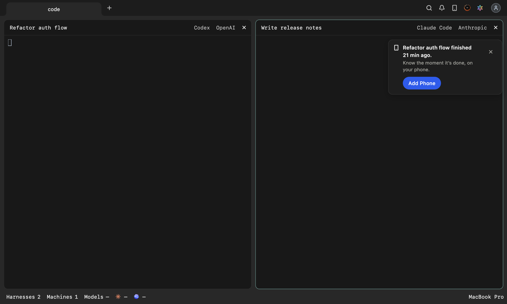
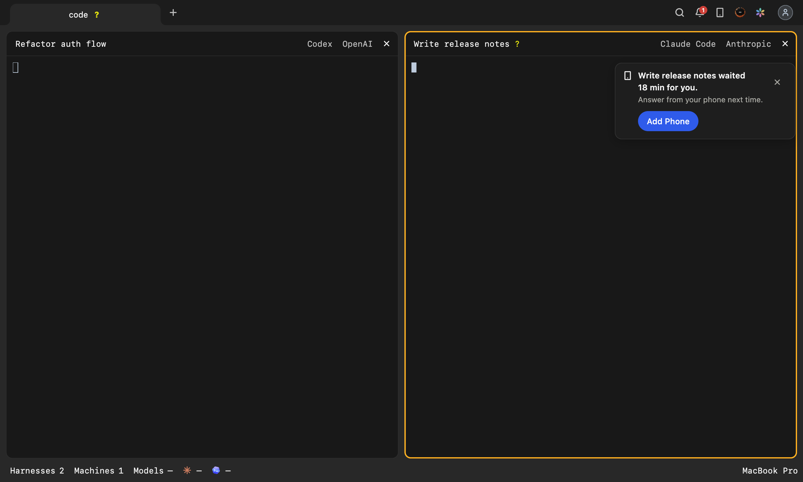
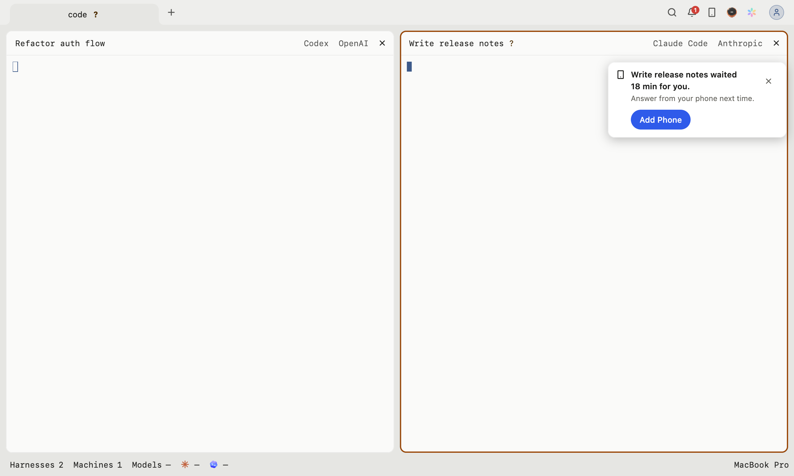

# Desktop to phone: offering Add Phone to people already at work

October 20, 2026. Built in `desktop/lib/state/app_state.dart` and `desktop/lib/widgets/phone_offer_card.dart`.

## Goal

Get more people who already work in the Harness desktop app to add Harness on their phone. Harness on the phone is
what lets a harness that finished, or that waits on a question, reach the person when they are not at the
computer. Desktop users without it miss that, and find out about it only from a phone icon in the title bar.

**Success:** in a week, a higher share of the people working on Desktop also use Harness on their phone. Each
card's own flow (below) shows whether it is the card that brought them there.

**Not in scope:** the notification offer (`notificationOffer`), the Add Phone dialog itself, mobile onboarding.

## What the data showed (October 13–19)

| | People |
|---|---|
| Opened Desktop | 180 |
| ...with a harness at work on it | 103 |
| ...of those, did not use Harness on a phone that week | 59 (57%): 17 working 3 or more days, 42 now and then |
| ...of those, also used it on a phone | 44 (43%) |

Counted per account, staff accounts excluded. The 43% is the baseline to compare against. The card itself asks a
narrower question, "is there a phone or browser on the account?", because that is what the window can check.

The reason most of the 59 never saw an offer is in the code, not the data: the Add Phone card was offered once per
computer, at the first launch as a guest or after the first sign-in by hand (`_offerPhoneAtLaunch`,
`_offerPhoneAfterSignIn`). **A computer that opened already signed in was marked offered (`phone_offer_done`)
without the card ever showing.** That is every computer updated from an older Desktop, and every launch after the
first. For those people, the only way to Add Phone was the title bar's icon, the menu, or the command.

## What is built

The same top-right card (`PhoneOfferCard`) as the first offer, at the moments below. Nothing else in the window
changes, and Add Phone opens the same dialog. The card stands below the top-right pane's header
(`AgentAlertBanners.footerDrop`), not over it: it stays until it is answered, and at the corner it covered that
pane's model and its ×, often the very pane waiting on the person.

### 0. Once at a returning account's signed-in launch (owner, 2026-10-26)

The October 26 daily report found no accounts with an older computer adding their first phone in four days,
among 307 accounts. The existing paths rarely ran for those people. This owner decision supersedes the
October 9 rule that an already-signed-in launch only marks the offer done for this case.

Offer the existing card once per account on this computer when the launch is already signed in, the account
has no non-machine device other than self in `loadDevices()`, no card has been dismissed with × and Add Phone
has never been opened here (`phone_offer_stopped`), this is neither web nor a viewer window, and no other
phone card is showing. Historical `phone_offer_done` and `phone_offer_seen` do not rule out this returning
account's launch offer. The account needs a stable identity and local state that can be read. The offer waits for the existing
asynchronous profile load, without delaying the workspace; an unavailable identity records no offer.

It is a card, never an automatic dialog, and waits for first arrival just like the existing card.
Write `phone_offer_returning.<account id>` only when `phoneOfferShown` says it is on screen. Closing the app
with it unanswered does not bring that launch card back. Closing before it is on screen leaves it eligible.
An unreadable device list (including an older CLI) shows nothing and writes no returning record, so the next
launch tries again. This path reads devices at most once per launch. It does not add reads to the existing
after-work retry limit.

Showing it writes `phone_offer_seen` to suppress the after-work card and increments `phone_offer_shows`.
The away card remains eligible until that combined count reaches three, or × / Add Phone stops it.
The returning flow is `phone_offer_returning`, with the same outcomes and no observation timeout.

### 1. Once after work, on a computer that never showed the card

A computer that has never shown the card gets it **once**, right after one of the person's own harnesses on it
finishes a turn without an error. It shows beside work that just went well, not over a launch. Same words as the
first offer.

- "Own harness" is the same test the window uses for its own work counters: not a shared computer, not a plain
  terminal, open in a pane of this window, not a subagent.
- Asked once per run. If the account's device list cannot be read, it asks again at the next finished turn, up to
  3 reads a run (an older CLI has no device list at all).
- A computer that already showed the card, or opened Add Phone, has seen it (`phone_offer_seen`).
- An account that already has a phone or browser marks the computer seen and shows nothing.

### 2. When the person comes back to news they missed

When the window has been away from the front for **5 minutes or more** (long enough to have left the computer, not
just looked at another window), and while it was away one of the person's own harnesses **waited on them** (a
question or a permission) or **finished**, the card shows when they come back. It says what a phone would have
told them while they were away:

| What happened | Title | Detail |
|---|---|---|
| A harness waited on them | `{Harness} waited {N} min for you.` | `Answer from your phone next time.` |
| A harness finished | `{Harness} finished {N} min ago.` | `Know the moment it’s done, on your phone.` |

- `{Harness}` is the harness's name as the window shows it; `{N}` is minutes since that news, at least 1.
- **A wait outranks a finish**: a waiting harness could not go on without the person. Between two of the same
  kind, the first one counts (the longest wait, the earliest finish).
- Only news that arrived while the window was away counts. News from before it left, from a shared computer, or
  from a plain terminal does not.
- The news is the one the system notification already reports (`_raiseAlert`, when the window is not in front).
  No new signal from the daemon.
- `{N}` and `min` are joined by a no-break space, so the title never wraps between them.







### Rules shared by every card

- Only on an account with **no phone or browser** yet (`loadDevices`). No list to judge by: no card this time.
  An account found to have one is not read again in that run: each read reaches the backend through the daemon.
- **Away cards stop at 3 combined showings per computer**, including the first offer, returning offer and after-work offer. The returning launch offer is once per account on that computer.
- **× or Add Phone opened (from the card or any other way in) stops the cards on this computer for good.**
- A card left unanswered stays on screen until the app closes or the person signs out. On a later run, the card
  after time away may come back, until the 3-card cap.
- Not in a viewer window, not signed out, not while another card is on screen.

### Why not ask about notifications here

The window already offers system notifications on its own (`notificationOffer`), and that offer is left as it is.
This card's job is one thing only: Add Phone. Mixing the two in one card would make neither clear.

## Where it is recorded on the computer

In the Desktop's local state file (`LocalKeyValueStore`, beside the dial's state):

| Key | Written when | Read by |
|---|---|---|
| `phone_offer_returning.<account id>` | returning card on screen, once per account locally | signed-in returning launch |
| `phone_offer_done` (existing) | Add Phone opened, card put away, the first sign-in finds a phone, or the returning card is on screen; older versions wrote it at signed-in launch | the first offer |
| `phone_offer_seen` | any card on screen, or Add Phone opened | the card after work |
| `phone_offer_stopped` | the card's ×, or Add Phone opened any way | the card after time away |
| `phone_offer_shows` | every card on screen, counted | the card after time away (cap 3) |

A state file that cannot be read is taken as "already done": no card, rather than a card at every launch.

## Measuring it

Each card is its own flow, so the moments compare with each other and with the first offer:

| Flow | Card |
|---|---|
| `phone_offer` | the first offer (existing) |
| `phone_offer_returning` | once at a returning account’s signed-in launch (vocabulary 6) |
| `phone_offer_after_work` | once after work |
| `phone_offer_away_waited` | back to a harness that waited |
| `phone_offer_away_finished` | back to a harness that finished |

Metric names are `ui_desktop_<flow>_<measure>`. `started` counts cards on screen, `ok` its Add Phone, `cancelled`
its ×, and `unknown` a card that went another way (Add Phone from elsewhere, a sign-out). The flows have no
15-minute bound, because a card waits beside the work. `started` minus the outcomes is cards still up when the
app closed. Every Add Phone opening keeps its own count by way in (`ui_desktop_add_phone_<opening>`).

The card's `ok` is a dialog opened, not a phone added. The final measure stays the weekly share of people working
on Desktop who also use Harness on a phone, against the 43% baseline above.

The new flows are **vocabulary 4** (`x-harness-usage-vocabulary`): the Desktop keeps them queued until the local
CLI says it forwards vocabulary 4, so a Desktop on an older CLI loses none and sends none early. The names live in
`PRODUCT_USAGE_DESKTOP_FLOWS` (`backend/src/types/productUsage.ts`, copied to `cli/src/lib/productUsageContract.ts`).

## Rollout order

1. **Backend**: accepts the new names.
2. **CLI**: forwards them and announces vocabulary 4.
3. **Desktop**: offers the cards and counts them.

A Desktop released first still offers the cards; its counts wait for the CLI.

## Tests

- `desktop/test/phone_offer_test.dart`: the after-work card (once, own harness only, account with a phone, list
  unreadable then asked again) and the away card (5 minutes, wait outranks finish, shared and terminal news
  ignored, news from before leaving ignored, × and Add Phone stop it, 3-card cap, the words on the card, the
  minutes never wrapped apart from `min`, the top-right pane's header left clear).
- `desktop/test/agent_alert_banner_widget_test.dart`: the card stands below the pane header alone, and right
  under the banners when there are some.
- `desktop/test/product_health_test.dart`: the new flows' vocabulary and that they have no 15-minute bound.
- `desktop/integration_test/phone_offer_away_native_test.dart`: the whole story in the real macOS window (leave,
  a harness finishes or waits, back 18–21 minutes later, ×), and the pictures above. Fixtures only: nothing
  reaches the daemon or the backend, no notification is posted, no sound plays. Not run by CI; to run it and
  write the pictures:

  ```bash
  cd desktop
  FLUTTER_TEST=1 HARNESS_PHONE_OFFER_SHOTS_DIR=/tmp/phone-offer-shots \
    flutter test -d macos --no-pub integration_test/phone_offer_away_native_test.dart
  ```

  The pictures are what Flutter draws: AppKit's title bar is not in them, and the tab row is Flutter's own.
- `backend/src/routes/productUsage.test.ts`, `cli/src/lib/appProductUsageReport.spec.ts`,
  `cli/src/hookServer.spec.ts`: the names are accepted and vocabulary 4 is announced.

## Known limits

- A computer that put the first card away before this release has only `phone_offer_done`, which cannot tell a ×
  from a signed-in launch. It may see the card once more, and left unanswered, the card after time away up to the
  3-card cap; a × or Add Phone then stops it for good.
- Away time follows the window (`appLifecycleChanged`), not the person. A window left behind another app for 5
  minutes while the person sat at the computer counts as away. The card then says what happened, which stays true.
- Counts are per computer, not per person: a person with two computers can see up to 3 cards on each.

## October 26 measurement additions

Vocabulary 6 adds the returning flow, `ui_desktop_phone_offer_skipped_<reason>`, and
`ui_desktop_add_phone_paired_<opening>`. The fixed reason list and precise count semantics are in
[product measurement](../product-measurement.md). The CLI forwards the names and announces revision 6;
Desktop queues them until then. Backend and CLI vocabularies remain identical.

The dialog already receives live `deviceJoins` notices. Read one account-device snapshot before opening,
then count each new non-machine key once per dialog, excluding keys already in that snapshot. Keep the
snapshot and deduplication set in RAM; report only the opening (`offer`, `titlebar`, `menu`, `account`,
`machines`, `command`). A returning card uses `offer`. Repeated notices, rebuilds, machines, notices after
close and another account's notices do not count. A second new phone does. An unreadable snapshot leaves
attribution unknown and keeps the dialog usable; a successful pairing handshake alone is not proof of a
new account device.
