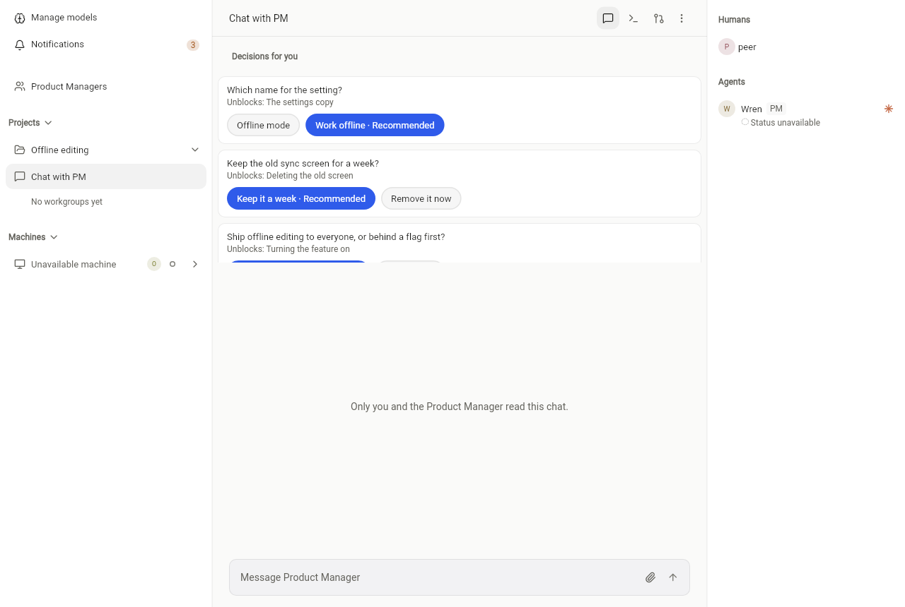
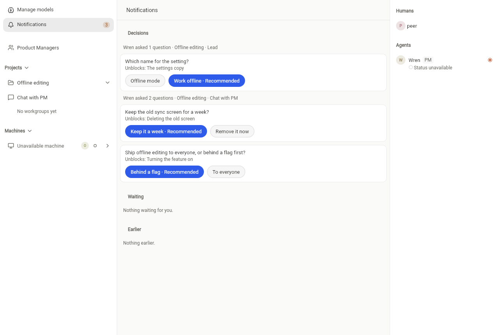
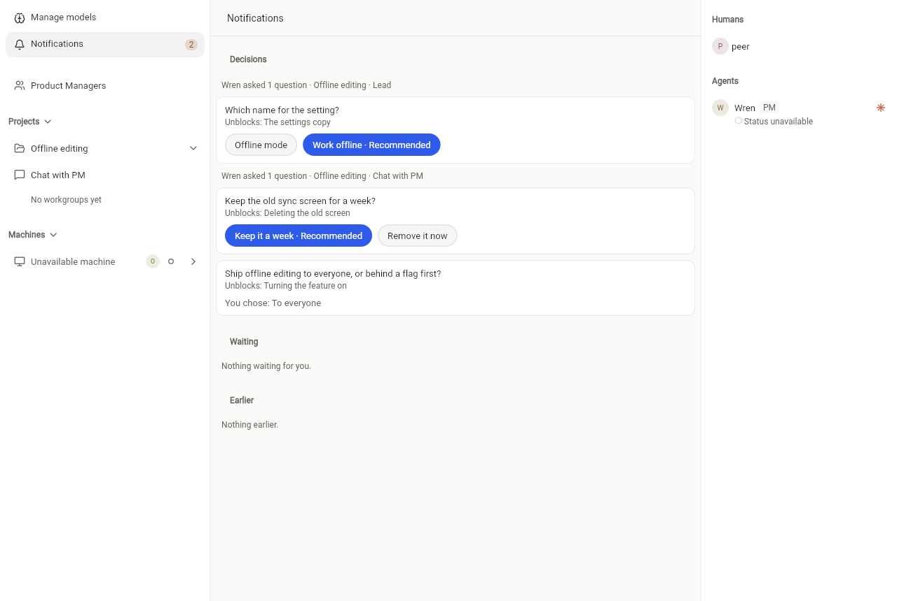

# Swarm decisions: questions to a person, in one place

Status: built on `feat/swarm-v2` (PR #1753). Brief: Lead, 2026-10-27, conversation "Decisions".

People were asked for decisions in scattered pings: a needs-human line in a work group, a tag in a Lead message, a
question in chat. A decision now has one shape and one place:

- **What a decision holds:**
  - one question;
  - 2 to 5 options;
  - the option the asker recommends;
  - what an answer unblocks;
  - the person asked;
  - the asking agent;
  - the conversation it came from, and the task, when it came from a worker's needs-human.
- **Who asks:**
  - The project's Lead, with `decision.ask`: up to 10 questions to one person at once, in one of its project's
    conversations.
  - A worker, on its own task, with `work.status` `needs_human` plus `ask`. The question is its result. Without
    `ask`, needs-human reaches the Lead as before, and the Lead asks.
- **Batching:** one ask is one batch. The person gets one list and one badge, not a ping per question, and sees the
  batch together ("Wren asked 2 questions · project · conversation").
- **Answering:**
  - The person asked taps one option (`decision.answer`), once. A viewer may answer what was asked of them.
  - The asking agent and the project's Lead get a notice in the conversation the question came from. Only they read
    it, and it carries none of the answer; it points them to `harness super-tab decisions --answered`, which checks who
    reads it. Other readers of the conversation see nothing: no message, no unread mark, no link (review of #1753).
  - The person must still be in the Swarm and still read that conversation, when answering and when an answer is
    retried. An answer in a quiet or archived conversation works like any other.
  - Asking the same open question again is the same decision, not a second one.
- **Provisional work:** the asker keeps working on its recommendation, marked provisional, until the answer arrives.
  The Lead and Builder skills say so.
- **Who reads a decision:**
  - The person asked: Desktop/web lists it in Notifications, and in their Chat with PM for that project.
  - The asking agent: `harness super-tab decisions [--answered]`.
  - The project's Lead.
  - Nobody else, the Swarm's owner included.

## A decision is not a private channel

A decision is about the work, and it is seen where the work is seen:
- The question a worker writes is in its own terminal.
- A needs-human question still shows in its work group.
- The answer is read through `harness super-tab decisions --answered`, in the asking agent's terminal.

Anything private goes through the person's Chat with PM. A decision asked there stays inside that private
conversation.

## Where it lives

- **Storage:** decisions are rows in `SuperTabDecision` (`backend/src/superTabs/decisions.ts`), outside the tab
  state, as mentions are. No state part changes, and an older backend ignores them.
- **Reads:**
  - `GET /api/super-tabs/:tabId/decisions?state=open|answered[&asAgentId=]`.
  - First load and changes carry the person's open count as `derived.decisionsWaiting`.
  - A light change read also loads the conversations the person's open decisions are in, so the count holds.
- **Team machines:** the read is on the team-session allowlist for agents (`backend/src/lib/teamSession.ts`).

## Seen on an isolated stack

Taken 2026-10-27 after the review fixes (the answer notice only the asker and the Lead read). Everything ran on 127.0.0.1:
- loopback MongoDB and Redis containers;
- the fake sign-in of the local backend recipe;
- this branch's backend;
- the web build of `desktop/tool/super_tab_local_review.dart` as the second person.

The Lead asked through the real `decision.ask`.
- The person's Chat with PM, with that project's open decisions above its messages:
  
- The Decisions list in Notifications, one batch per ask, with the recommendation marked:
  
- After one tap. The choice shows and the count drops. The person's Chat with PM gets no message and no unread mark.
  The Lead's notice there carries none of the answer, and the Lead's decisions read has it:
  
