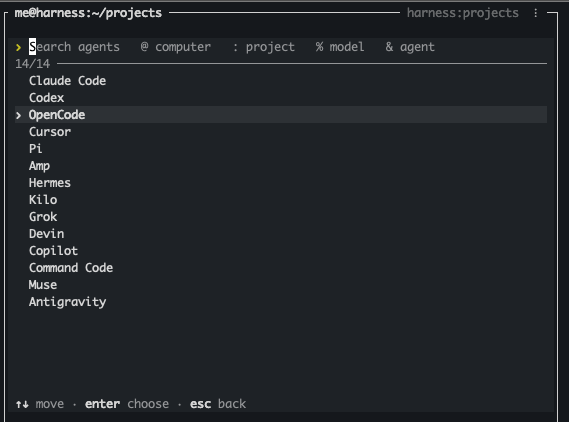
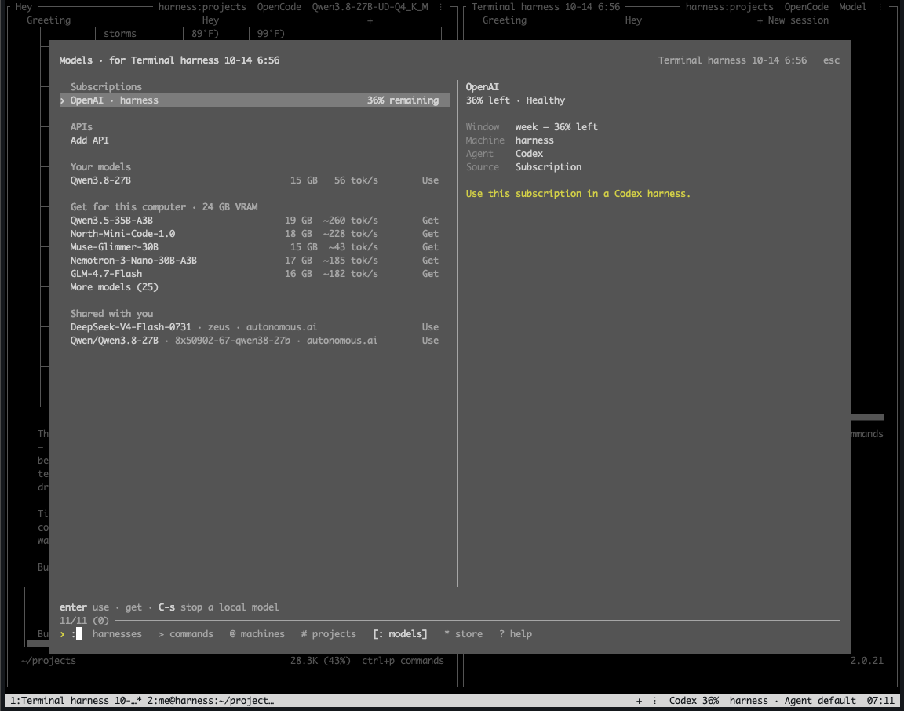
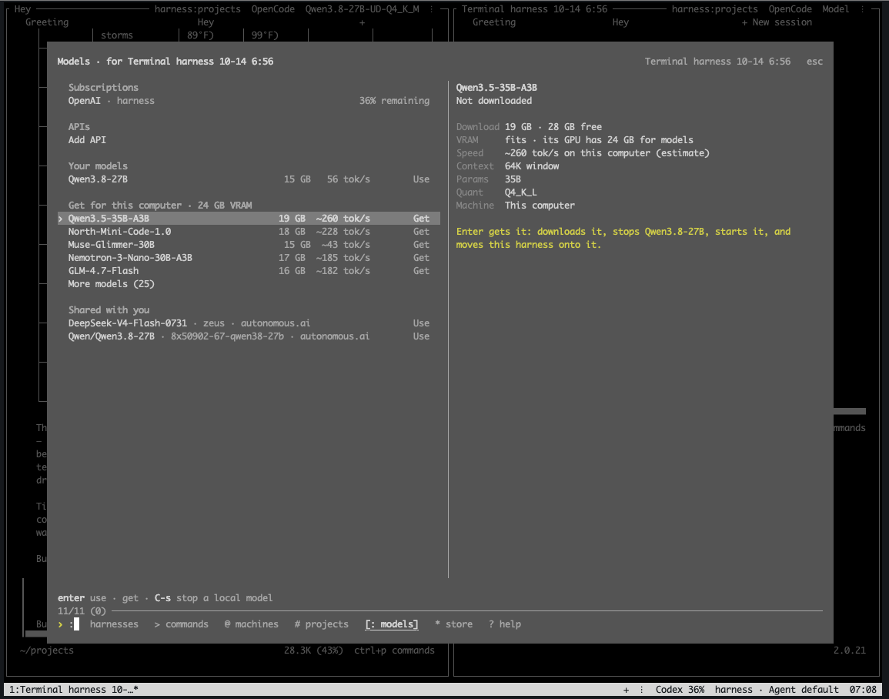
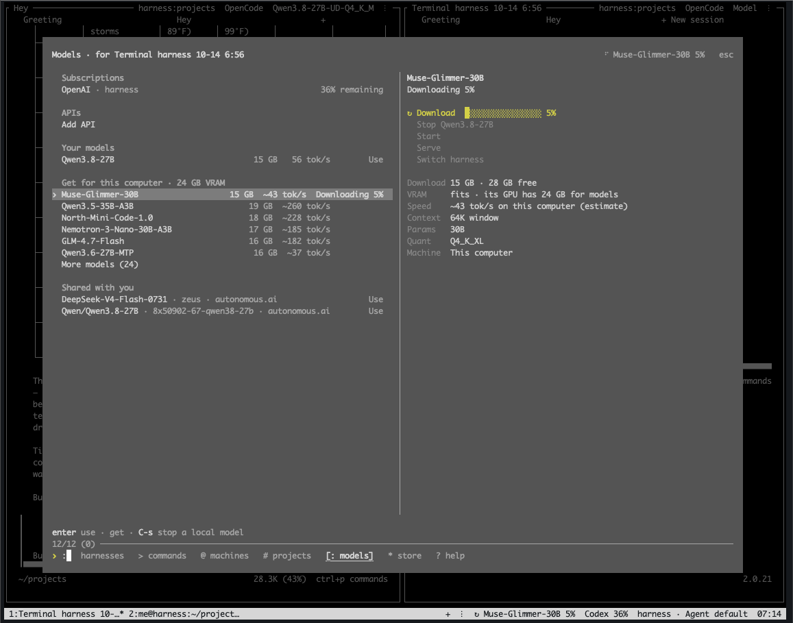
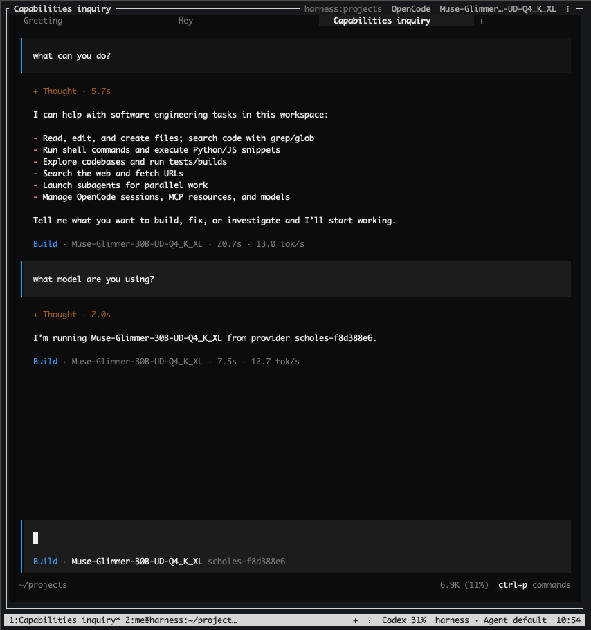

# Download and start a local model in hn

A local model runs on your own computer instead of a provider's servers.

## 1. Install hn

In a terminal, run:

```
curl -fsSL https://harness.autonomous.ai/cli/install.sh | bash
```

Then type `hn` and press Enter. The first time, hn signs you in.

## 2. Open a harness

Open the harness that will use the local model: press Ctrl+B, then Shift+N, choose an agent with the Up and Down arrow keys and press Enter. Claude Code, Codex, OpenCode can use local models.



## 3. Open Models

In the harness, press Ctrl+B, then Shift+I. The Models screen opens for that harness.

If you see **Set up local & shared models**, press Enter on it first.



## 4. Choose a model

**Get for this computer** is the model catalog: models that fit this computer's memory (on NVIDIA, its GPU's VRAM), ranked for coding. Each row shows the download size and estimated speed.

Use the Up and Down arrow keys to select a model, then press Enter twice.



## 5. Wait

hn downloads the model, starts it and moves your harness onto it. Downloads are often 10–20 GB. If one stops, press Enter twice on the model again to resume it.



## 6. Done

Your agent now answers with the local model.


