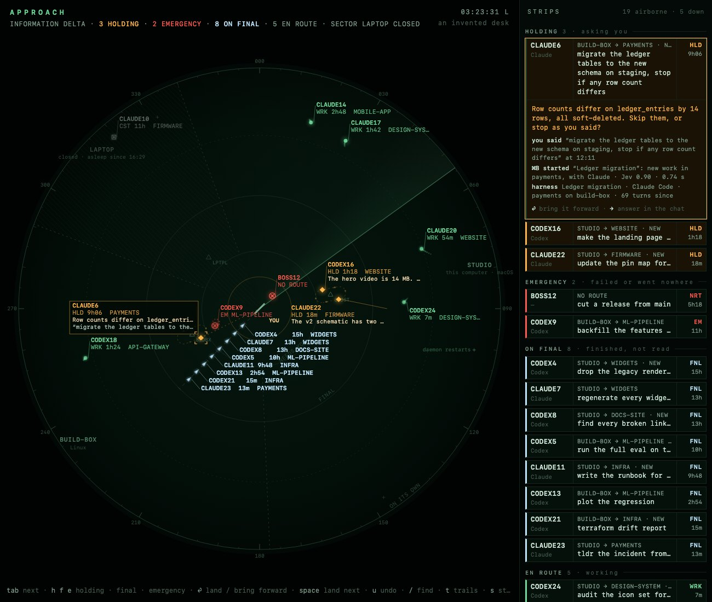
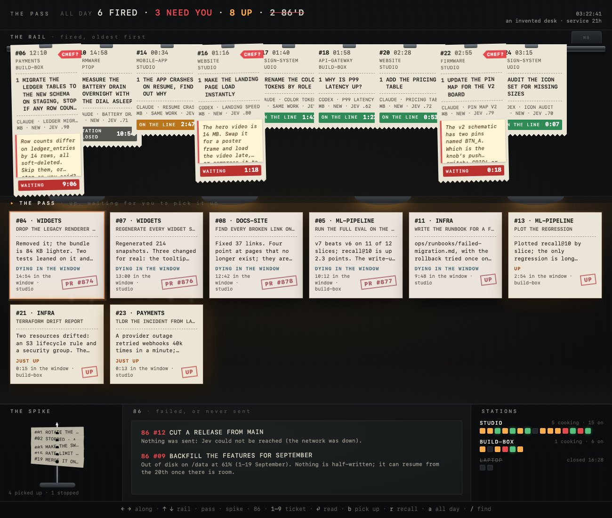
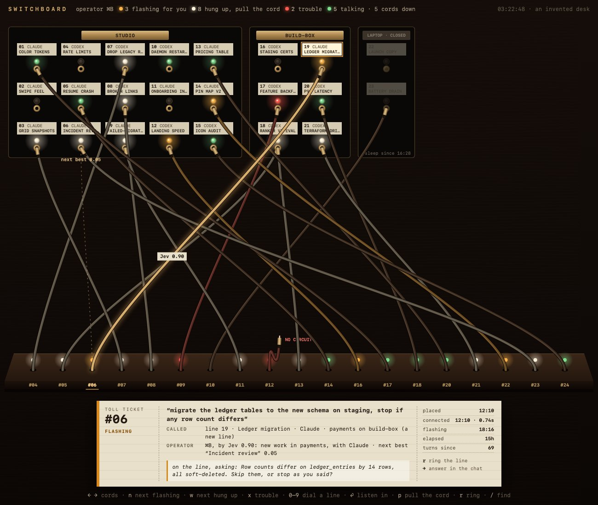
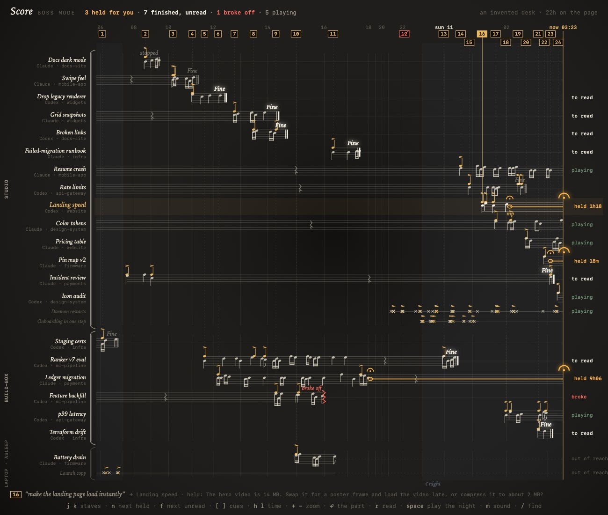

# Boss Mode: ⌘B's office

> **Dropped, 2026-10-11.** The owner found these four metaphors hard to follow, and the reason for a Boss
> Mode harness went away the same day: it was to be where a person set up their Jev key, and Harness now
> pays for ⌘B's Jev instead (#1174, docs/design/2026-10-09-auto-router.md), so ⌘B needs no setup. Kept
> as a record. If people lose track of what they sent with ⌘B, start from a plain list of recent sends
> under the ⌘B box, not from a metaphor.

2026-10-11. ⌘B sends a typed task to the harness it belongs to, or starts a new one, in about 0.6 s
(`docs/design/2026-10-09-auto-router.md`). It has to stay that fast, so it stays a box. Boss Mode is a
Store harness in Essentials that serves as ⌘B's office: a viewer of everything ⌘B dispatched and
where each task stands now. It shows which harness took a task, whether it is working, waiting on you,
done or failed, how long ago, and on which machine. The real agent chat sits to its right
(70% viewer / 30% chat, `desktop/design/dsh-workspace.md`), where you ask the boss "where is the ledger
migration?", "what's stuck?", "what finished overnight?".

These are four viewer prototypes for that office. They were made the way the
[Memories brain prototypes](../2026-10-10-memory-brain/README.md) were made: one shared data module,
a loopback server that can show your real desk, an invented desk by default, and four concepts that
each own one idea. Each has to answer two questions at a glance: **what did I hand off, and what
needs me?**

## How to open them

```bash
node docs/research/2026-10-11-boss-mode/serve.mjs 47612
open http://127.0.0.1:47612/            # an invented desk that keeps moving
open "http://127.0.0.1:47612/?real"     # your own desk, read only
```

On the invented desk, tasks finish, ask questions and arrive while you watch. `?still` holds it in
place (the screenshots use it), and `?select=d06` opens on one task. Every page also opens straight from
the file system on the invented desk. Nothing here sends anything to a harness: Enter on a task that
needs you only says what Harness would do ("would bring it forward").

## Four concepts

| | Taken from | The one idea | At a glance |
|---|---|---|---|
| [Approach](approach.html) | Air traffic control: an approach radar, flight strips | **The nearer the centre, the more it needs you** | Amber targets hold at fixes beside you; finished ones line up on final |
| [The Pass](pass.html) | A restaurant's expo station: the ticket rail, the heat lamps, the bump bar | **Finished work dies in the window if you leave it there** | "ALL DAY 6 FIRED · 3 NEED YOU · 8 UP · 2 86'D" |
| [Switchboard](switchboard.html) | A cord switchboard: jacks, supervisory lamps, toll tickets | **Where your words went, and how sure the operator was** | Flashing lamps want you; steady white lamps mean pull the cord |
| [Score](score.html) | A conductor's full score: cutaway staves, rehearsal marks, fermatas | **What happened since you handed it off, read like music** | Amber fermatas held at "now"; a bright *Fine* is unread |

1. **Approach.** You are the airfield at the centre of a radar scope. ⌘B is a departure: the task takes off
   and climbs out to its machine's sector. Working tasks fly there, and the sweep paints them once per
   scan, leaving history trails. A task that asks you something enters the holding pattern at its
   machine's fix, near the field, and flashes. Finished tasks line up on the final approach course and
   wait for you to land them (read them). A failure squawks an emergency; a task ⌘B sent nowhere sits at
   the field with "no route". Harnesses ⌘B never sent anything to show as untracked primary returns. The
   strip bay on the right holds a flight strip for every task, most urgent first, and the ATIS line
   counts the desk. Keys: `tab`, `h f e` (holding, final, emergency), `⏎` land, `space` land the next,
   `u` undo, `/` find, `t` trails, `s` strips.
2. **The Pass.** Every handoff is a thermal-paper ticket that the printer fires onto the steel rail, oldest first.
   A cook with a question flags its ticket CHEF? and clips the question to it, with a waiting timer
   that turns red. Finished work comes up on the pass under heat lamps. It starts warm, with steam, and
   cools while it waits. Past three hours it is "dying in the window". Read tickets go on the spike;
   failed ones are 86'd on the board. The stations show every cook on every machine. The keyboard is a
   kitchen's bump bar: `← →`, `↑ ↓` between rail, pass, spike and 86, `1–9`, `⏎` read, `b` pick up,
   `r` recall, `a` call all day.
3. **Switchboard.** ⌘B is the operator. Every harness on every machine is a line with a jack, a jewel lamp
   and a designation strip, in a panel per machine under a brass nameplate. Every task is a cord from the
   keyshelf to the line that took it. The lamps work the way supervisory lamps did: a flashing lamp is a
   line signalling the operator (it needs you), a steady white lamp means the call is over and the cord is
   waiting to be pulled (done, unread), red is trouble, green is talking. The selected cord shows
   **Jev's confidence** on the cord, and a **ghost cord** runs to the line ⌘B nearly chose. Its toll ticket
   logs the call: what you said, the line, the operator's reasoning, and placed, connected and hung-up
   times. Enter listens in: the call's rhythm since it was placed, your turns above the line and its
   turns below. Keys: `← →` cords, `n` flashing, `w` hung up, `x` trouble, `0–9` dial a line, `⏎` listen
   in, `p` pull the cord, `r` ring.
4. **Score.** The desk is a full score. Time runs left to right, with one staff per harness, grouped and
   bracketed by machine as an orchestra is by family. Like an engraver's measures, each bar is as wide as
   what happened in it, so a quiet night folds up and a busy hour opens out. Each task you handed off is a
   boxed rehearsal mark, and its cue drops to the staff that took it. Turns are notes, beamed when the
   harness played fast; your own turns are gold accents. A harness that finished ends in a double bar and
   *Fine*. One that needs you holds a **fermata**: its last note is sustained, glowing, to "now". It is a
   cutaway score, so staves appear when a harness enters, and harnesses ⌘B never sent to are one-line
   percussion staves. Keys: `j k`, `n` next held, `f` next unread, `[ ]` cues, `h l` time, `+ −` zoom,
   `⏎` the part (the score makes room for it), `space` plays the night back, and `m` adds sound.

All four are keyboard first, run without libraries or network, and render every task, question and
summary as text only, because those are written by people and models and may contain anything. In
headless Chromium at the pane's size (1300×1100) and at 760×980, none logged an error or requested
anything off this computer, on the still desk, on the moving desk for 70 s with keys pressed, and on a
real desk (`shoot.mjs` checks the first).

## Screenshots (invented desk only)

| | |
|---|---|
|  | **approach.jpg**: three tasks holding near the field (one for 9 h), eight on final, two emergencies, the laptop's sector closed. **approach-final.jpg**: a finished task picked on final. **approach-narrow.jpg**: the strip bay drops below the scope. |
|  | **pass.jpg**: the rail with three CHEF? flags, eight plates up and cooling, the spike, the 86 board. **pass-ticket.jpg**: the ledger migration's ticket read in full. **pass-narrow.jpg**: the stations fold away. |
|  | **switchboard.jpg**: the ledger migration's cord to build-box, "Jev 0.90", its ghost to the next best line, and the toll ticket. **switchboard-listen.jpg**: listening in. **switchboard-narrow.jpg**. |
|  | **score.jpg**: 22 hours on the page, three fermatas held, the night folded up. **score-part.jpg**: a held harness's part beside the score. **score-narrow.jpg**. |

Run `PLAYWRIGHT=<path to playwright/index.mjs> node docs/research/2026-10-11-boss-mode/shoot.mjs [page]`
to retake them; it fails on any console error or off-computer request.

## The data model: what the Boss Mode harness would keep

The prototypes all read one shape (`boss-data.js`). The invented desk is built in it. The real adapter
(`serve.mjs`) fills as much of it as Harness keeps today.

```
desk
  now, real
  machines    { id, name, here, online, since }
  harnesses   { id, machine, engine, name, project, state, since, createdAt, lastTurnAt, tokens,
                question, summary, turns: [{ at, by: you | agent, size }], boss }
  dispatches  — the office's book: one row per task handed to ⌘B
    id, n                  #06
    at                     when you pressed Return
    text, via              what you typed or said; box | voice | phone | dial | tui
    decision               { kind: session | new | none, p, runnerUp: { name, p }, why, ms, cost }
    harness, machine       the harness it landed in (a new one when decision.kind = new)
    created, landedAt      whether ⌘B made the harness; when the words were typed into it
    state, since           routing | working | asking | done | failed | stopped | offline | undelivered
    history                [{ at, state }] every change since the dispatch
    question               what it is asking you, when asking
    summary, error, pr     what it did, what went wrong, the pull request it opened
    seenAt                 when you picked a finished one up: done and not seen is "needs you"
```

"Needs you" has four causes: **asking**, **failed**, **undelivered** (⌘B decided nothing, so nothing was
sent), and **done but not yet seen**. The fourth is why `seenAt` belongs in the office's book. The
desktop's "done (unread)" (`harness_activity.dart`) depends on a pane having been opened, while the
office's depends on the person having read the result. The prototypes keep `seenAt` in the browser for
now.

## Your real desk (`?real`) and what is missing

`serve.mjs` reads, on each request and never writing:

- **Every harness on every reachable machine**, through the daemon's local bridge, the way Harness
  Monitor does (`machine_select`, then `agents_list` with `monitor: true`, through
  `store/agents/harness-monitor/lib/inventory.mjs`). This gives each harness's state (working, needs
  input, done, failed, stopped, offline), machine, project and tokens.
- **What you said to each harness, and when**, from the session index (`session-search.db`, opened
  read-only through `store/agents/memories/lib/sessions.mjs`).
- **What each harness last said**, from the daemon's turn summaries (`summaries.json`).
- **⌘B's recent prompts**: the `task_box_recent_v1` key of the desktop's state file
  (`~/.harness/desktop-app-v2/state.json`). Only that key is read; that file also holds credentials.
  Each prompt is matched to the newest message with exactly those words in the session index, which
  says when it landed and in which harness.
- **How sure ⌘B was**: the router's `[route]` lines in the daemon log, when they are still there.

**⌘B's routing history is not persisted anywhere usable.** The prompts kept for the box are text only,
with no time or destination. `lastRoutedTask` exists only in memory (`app_state.dart`). The router's log
lines name the chosen harness and the runner-up with their probabilities, but carry neither the text
nor an id, and the log is halved once it passes 10 MB. On one real desk, the one prompt the box
remembered matched no message this computer had indexed. So `?real` shows each harness's latest
message from the last 36 hours as a handoff. Those typed into the pane are marked as such ("typed into
the pane", a cord with no operator), and ⌘B's prompts show as ⌘B's when they can be matched. Each page
says which notes apply.

What the office needs before it can be built for real:

1. **A dispatch log.** The router (`cli/src/services/router.ts`) is the one place every client's decision
   passes, but it only decides; the client acts. It could append each decision (text, time, kind, Jev's
   pick and runner-up, cost) to a small append-only log. The client could then confirm the landing with
   the agent and session it used, which the desktop already knows when it calls `markLanding`. That is
   the `dispatches` table above. The viewer joins it to `agents_list` for the live state.
2. **States that survive a restart.** `monitor.activity` is `done` or `failed` only from the last
   `turn_ended` held in the daemon's memory (`cli/src/lib/harnessMonitor.ts`), so a daemon restart
   forgets that a harness finished or failed.
3. **The question itself.** A `commander_question` reaches a tool connection only when it connects
   (`cli/src/core/questions.ts`), so a viewer reconnects to learn what is being asked. The office wants
   the question text with the agent row.

## The workspace

These pages are the left 70% of the workspace. The right 30% is the Boss Mode agent's chat. Its tools
would be the same reads `serve.mjs` makes, plus the dispatch log. A page can tell the chat what "this
one" means by writing its selection to the viewer's state file, as Memories does, so "answer it" or
"why did it fail?" in the chat applies to the strip, ticket, cord or staff that is selected.

## Files

- `boss-data.js`: the shared data module, the invented desk and its simulation, and `?real`.
- `serve.mjs`: the loopback-only server and the read-only real-desk adapter.
- `index.html`, `index.js`: the picker.
- `approach.*`, `pass.*`, `switchboard.*`, `score.*`: the four prototypes.
- `shoot.mjs`: takes the screenshots and checks every page, on the invented desk only.
