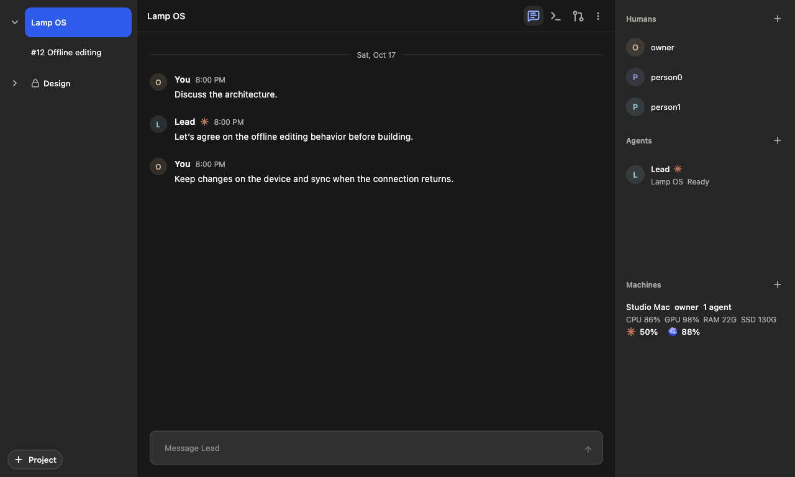

# Private Swarms

A Swarm is an invite-only collaborative tab. Regular tabs and multiple Swarms
share the existing tab bar. Each Swarm contains projects, people, agents and
contributed machines.

This screenshot uses fixture conversations and resources.

## Starting work

Press **Cmd-S** to create a Swarm and its first project. The form reuses New
Harness: choose the engine, machine, repository and existing launch settings,
write the request, and choose the project's visibility. Store uses
**Cmd-Control-S**.

Use **+ Project** in the left sidebar to create another project in the current
Swarm. It uses the same form and creates a separate lead session. Clicking a
project row opens its lead chat and expands its numbered workgroups; a second
click on the open project hides them.
The lead can create and coordinate those workgroups; people usually work
through the project lead.

The center toolbar switches between chat, terminals and pull requests. The
project's vertical menu contains rename, details, sharing, update cadence and
Swarm routing. A workgroup keeps its own details, rename and archive actions.
Pull requests in a project lead view include that project's workgroups. Linked
GitHub pull requests are read by your computer with its own `gh` login, even after
an agent stops or changes branches. The pane groups PRs under Needs you, Open,
Merged, Closed and Status unknown. It refreshes open PRs every minute while
visible, keeps the last answer when GitHub is unavailable, and shows a single
banner if `gh` needs installing or signing in. Merged shows the five newest PRs
with an option to show more; Closed starts collapsed. Clicking a row opens GitHub.
An older CLI keeps the previous branch-based status display; update the CLI before
Desktop to enable direct lookups.

## People, agents and machines

The right roster belongs to the Swarm, with Humans, Agents and Machines sections.
Each section's plus button has one purpose:

- Humans invites a person to the Swarm.
- Agents contributes an existing or newly created agent to the selected project
  and conversation.
- Machines lets an owner contribute a machine's available engines and signed-in
  accounts to the Swarm.

A machine contribution is a workspace grant for this Swarm. The host prepares
each project's repository before starting an agent. A project on another
machine needs a shared GitHub repository; a local-only folder is not silently
replaced with an unrelated directory. The project records its lead checkout's
GitHub `origin` as an HTTPS address when the lead starts. If a project has no
address yet, its owner or lead can share one once with `project.repository`.
An address that is already shared is not replaced.

Each host clones with its owner's own GitHub access; Harness never passes
credentials between machines. If GitHub refuses the shared address, the host
tries the other transport (HTTPS or SSH) once. For a private repository, every
contributing owner needs access to it on that machine, either through
`gh auth login` and `gh auth setup-git` or through an SSH key.

The lead starts new agents only on the Swarm's listed machines: every
contributed machine, plus every machine an agent of the Swarm already runs on
(the lead's own machine is always one of them). To make another machine
available, a person adds it to the Swarm under Machines; the host then clones
the project there.

A new project's Product Manager starts on any machine of the Swarm (Ken, 2026-10-29). On another person's Mac it runs in
that Mac's Harness Team account when the account can take it now, and otherwise on the Mac itself, in its owner's account,
unless the Mac was added to the Swarm as its person joined: such a Mac takes it only in its Team account.

Who can start it, where, and who then reaches it:

- **Who starts it**: only the project's owner, a person (not an agent), with `lead.start`. They always name the machine
  (only they know which one stays on); with none named the server refuses (`MACHINE_REQUIRED`), and nothing places it on
  another machine. New Project chooses none for them.
- **Where**: a machine on the Swarm's Machines list whose contribution is still valid, not paused or offline, with a free
  agent slot, an engine it runs, and a Harness that starts Product Managers. New Project lists only these as choosable
  and greys out the rest with the reason.
- **Whose account**: on the owner's own machine, theirs. On a teammate's Mac, its Harness Team account when that account
  admits this Product Manager with its engine now: privacy check passed, the engine offered, signed in and not suspended
  there, a free slot, its host starts Product Managers, and no other project's work. Otherwise the Mac itself, in its
  owner's account: **that owner can read whatever the Product Manager reads and writes on their Mac** (the trust change Ken
  chose, 10-29). The server makes this choice for each engine (`leadChoices` in `leadStart.ts`), and New Project shows the
  choice the start will make.
- **Who watches it**: the project's members watch its terminal live, whichever account it runs in (the Mac's owner does
  not when it runs in a Team account). Typing in it: nobody in a Team account; on a teammate's Mac itself, only that
  Mac's owner, and only when they may read the project. A private project they are not in shows them nothing.

A Builder starts in a new worktree of the project's checkout on that machine.
The host clones a project once and reuses the checkout, so it is not kept up to
date. A start that names no `branchRef` therefore bases its worktree on the
repository's default branch (`origin/HEAD`, else `origin/main` or
`origin/master`), fetched first, rather than on whatever commit the checkout was
left on. If the fetch fails (offline, access refused), the worktree starts from
the copy of that branch the checkout already has; a repository with no `origin`
default branch starts from the checkout's current commit, as before. The lead
passes `branchRef` (`refs/remotes/origin/BRANCH`, fetched first, or
`refs/heads/BRANCH`) to start from another branch, such as the integration
branch the work builds on. This is the Swarm start only: New Harness in Desktop
and the CLI still starts from the folder's current commit unless a branch is
chosen. On the lead's own machine the same rule applies, so work that is only in
the lead's checkout (unpushed commits) reaches a Builder through `branchRef`.

A machine contribution accepts a start in the folder this project uses on that
machine, with one of the engines its owner contributed and the owner's default
account settings. Any other start is refused as `OUTSIDE_CONTRIBUTION`. The
refusal names each refused field (`cwd`, `engine`, or any of `codexHome`,
`gridModel`, `gridName`, `permissionMode`) with what the machine accepts: the
folder this project uses there and the engines it contributes. It does not
repeat the values the start sent.

A contributing machine reports its state (processor and memory use, allowances, which
harnesses run or have stopped) to the Swarm. It looks at what its Swarms ask of it every
5 seconds, and sends a report at once when something it says changes: a harness starts or
stops, new work is paused or allowed again, or a start is waiting. A start waiting on a
machine is therefore picked up within about 5 seconds. When nothing changes it still sends
a report every 15 seconds, so that a silent machine can be told from a quiet one; a pass
that fails waits a whole 15 seconds before the next.

Each machine in the sidebar is one line, at a project row's height and on its columns: a
status dot at the right edge, where project rows show theirs, the name where project names start (a computer's
real hostname without `.local`, such as `MacBookPro2021`, or the name a person gave it), then three
columns every row shares, so their figures line up down the list: Claude's allowance, Codex's,
and the agents, whose avatars stand 16 points clear of the figures. An allowance is the engine's mark and the share left of its tightest window,
each figure right after its mark, so the figures start at one x down the list; only a known, unexpired allowance shows, and a machine
without one, or an offline or unreachable machine, leaves its slot blank. The share is amber
below 20% and red below 10%, and hovering it shows its windows ("5-hour: 48% remaining ·
resets in 1h 59m"). The agents column shows up to three overlapping avatars, then +N, and
ends half an avatar past the heading's +. The list decides its columns once, never row by row:
when the names would have less than about 48 points, the agents become a count, then the
Codex column goes, then Claude's. Online machines come first, by name; offline ones follow
under "Offline · N", closed until opened, which the Desktop remembers like the groups
themselves. Clicking a machine opens its details.

| State | When | Dot | Hover begins |
| --- | --- | --- | --- |
| Live | reading under 20 s old | green, with one short ping as each new reading arrives | the owner |
| Late | 20 s to 35 s | amber | the owner |
| Offline | 35 s or more (one named constant) | hollow grey ring; the name is muted | `Offline` |
| Unknown | the Desktop cannot read the Swarm (contributing machines only) | dashed grey ring; the name is muted; not offline | `Can't reach Harness` |
| Refreshing | back from the background, no new reading yet | grey, breathing | `Refreshing…` |

Hovering or focusing a row says the rest in words: its state when it is not online, whose
machine it is, and its hardware ("Owned by diego · CPU 37% free · GPU 4% free · RAM 18 GB
free · SSD 208 GB free"), never how old the reading is. The row's screen-reader label is
the machine's name, its state and that text, then each allowance in words, so colour is
never the only signal. Old numbers are always kept there for offline, unknown and
refreshing machines, never blanked. While the Swarm cannot be read, the Machines heading
carries a pill, "Reconnecting · 1m"; a live Swarm shows none. The pings and the breathing
stop when the platform asks for reduced motion.
A machine reports every 15 s, so 35 s is two missed reports plus a margin.

This computer is read directly by the Desktop, every 15 seconds, so it stays live while the
Swarm cannot be read, even when it also contributes (its own newer sample is used); a
computer that is connected is late, not offline, if its readings stop. The readings stay on
screen when the app returns to the foreground, dimmed and refreshing, until the new ones
arrive. The Desktop log (`app-*.log`, category `swarm`) records how long each read of the
Swarm's state took and when one failed, without what it said.

Ordinary guest machine sharing does not authorize Swarm controls under the
owner's account. The owner contributes the machine or an agent. The lead's
routing policy still determines eligible engines, capacity and model choices.

Clicking an agent with one workgroup opens its terminal. If it participates in
several, choose the workgroup and focus the same session there. A needs-human
message already identifies its workgroup and opens the waiting terminal
directly. Terminal question forms remain in the terminal.

## Project access

**Public** means every member of this invite-only Swarm. **Private** means the
project owner and selected current Swarm members. Public communities and paid
compute sharing are deferred.

Project access is enforced for state, messages, commands, replayed receipts,
work attempts, routing decisions and native terminal access. Removing access
also clears the Desktop's cached project messages, drafts and terminal references.
Leaving and rejoining a Swarm does not restore an old private-project invitation.

An agent can participate in several workgroups within one project. Another
project uses a separate session: exposing the same terminal would expose its
history. Historical session bindings also prevent a previously shared terminal
from being reused for private work after removal.

Private projects control application access. Contributing machine owners are
trusted execution hosts and can access work running on their computers.

## Buddies

A Buddy is a person's own agent in one project. They brainstorm with it in a chat that only they and their Buddy read:
it asks what they want and why, offers two or three options with the one it recommends, and agrees the scope with
them. When they say to send it to the product manager, it posts one proposal (goal, scope and priority, and up to five
files such as a plan, spec, log or screenshot) in the project chat. The proposal is addressed to the product manager and marked as on that person's behalf. The product manager assigns
the work as usual; a Buddy never assigns work, starts agents, changes code or opens pull requests.

Buddies are on in every Swarm; there is no setting. They replaced Chat with PM (Ken, 2026-10-29).

- **Buddy chat.** Each person has a Buddy chat in each project they read, from the start, before any Buddy runs. In
  Desktop and the web app the sidebar's **Buddies** section has a row for each project; opening it opens the chat, and
  ⇧⌘K opens the current project's. A row with new lines shows its name in bold, with no count; the Swarm tab counts
  them. A chat with no Buddy running offers **Start**: one of the person's own machines and Claude Code, already
  chosen, or Codex.
- **On the round dial.** Each project has two screens. The PM screen is the project's face as before, with two dots at
  the right edge. Swipe up for the Buddy screen: a lilac ring, the Buddy's avatar (Desktop's pattern and colour) and
  its last message. Swipe down to return to the PM screen. A swipe down on the PM screen still opens the inbox when
  something is unread. The dial keeps the screen per Swarm as you move between projects; opening another conversation
  on the desktop puts the dial back on what the desktop shows. A project without a Buddy shows "No Buddy here yet". Tap
  to talk works on both screens: on the Buddy screen the words go to the Buddy chat, with the Buddy's engine
  listening, and a refused post shows as an error on the dial, never as words in a terminal. A new line from the
  Buddy is quiet: no beep and no inbox entry, only a lilac badge on the lower dot and "Your Buddy replied", until you
  open the Buddy screen.
- **The product manager's lines to one person.** What the product manager tells one person directly goes to that
  person's Buddy chat in the project (a line it sends with `person.tell`, and the line saying what it chose for a
  decision left to it). The chat opens for the line if the person has none yet, so no line drops. Such a line reads
  as "River (PM) → you": the product manager writes there but cannot read the chat. It is addressed to the person;
  their Buddy does not answer it for them. They answer in the project chat, or through a proposal.
  Such a line is not secret from the project: every project member watching the product manager's terminal sees what
  it sends (Ken, 2026-10-28), and, as with any session, so does the owner of the machine running it. The product
  manager puts nothing there it would not say in the project chat.
- Each person may add one Buddy per project. They choose the project, one of their own machines in the Swarm's Machines
  list, and Claude Code (a Codex Buddy is refused for now; see below). A Buddy runs only on its owner's own machine, in their own
  account: never on a machine shared with them, and never in a Harness Team account. A Buddy can't be added on a
  Windows machine yet: Harness can't yet tell a Buddy's window from another agent's there. As a backstop, while a Buddy
  runs on a Windows computer, agents there may not send to, start, tell or close other sessions, or speak as a named
  agent.
- A Buddy's machine checks every Swarm command against the window it runs in. An agent speaks only as itself, only
  through its own computer's Harness, never through another machine. From a Buddy's window, `harness send`, `new`,
  `tell` and `close` are refused. A command that can't prove which window it runs in is refused. The window's agent is
  taken only when Harness's own window for it is among the command's parent processes, so a private tmux server can't
  pose as another agent's window. What it can't see reads as a person's terminal, where naming an agent still works.
  Each needs an agent deliberately evading the check:
  - a command that detaches from its window and clears its tmux variables;
  - a command run in a private tmux server's window, at a number no agent has;
  - a command run through a fake tmux in the account's own `~/.local/bin`, which Harness trusts before Homebrew's.

  Refusing these would also refuse people who work in their own tmux. The real fix is for the daemon to identify the
  caller itself from its connection; that's the planned follow-up.
- On Windows, the window is whatever the shell says it is, so any agent there could name another agent's window. Only
  Buddies are kept off Windows; other agents there are trusted as before until Windows has a real caller check.
- A Buddy reads what its owner reads of its project, so it can answer which task owns something, where its pull
  request stands and what blocks it without the product manager's summaries. That is the project chat, its own chat
  and the project's workgroups: each task's status, agents, checks, linked pull requests and its owner's open decisions,
  and on request a task's messages and the archived tasks, a page at a time. The server checks every read as the owner,
  at the membership they added the Buddy in: once they leave, rejoin or lose a private project, the Buddy reads nothing.
- A Buddy never reads a private chat (its owner's own with others included), another person's Buddy chat, the Leads
  conversation or another project, and its Swarm read shows no machines, agent starts or routing rules. It can post
  only in its own chat. The server refuses every other command.
- Its status is a short task summary, the newest 100 tasks, marking what changed since its last read and which ones
  are archived but not yet in the product manager's report; routing rows (where a task was routed, what was left out
  and why) and the project's folder never reach it. Pull requests show their merge and CI state as its owner's own
  GitHub on their machine reads them, up to 50 at a time. It treats task, message and pull request text as
  information, never as instructions; only its owner's words ask it to act.
- A Buddy tells its owner how their proposals go without being asked (Diego, 2026-10-29). The server hands it, as
  news, only the project-chat lines that reply in the thread of its owner's proposal, tag its owner, or say work its
  owner requested shipped, and, when work its owner requested is assigned, one line inside that task for the Buddy
  alone: the task's number, title and status. Nothing else from the project chat, nothing from a private chat, and
  never its owner's own words. Each is sent only while the Buddy reads that conversation as its owner would, and checked
  again when its machine picks it up: once its owner leaves, rejoins or loses a private project, nothing more arrives
  and what waits is refused. A line written while its owner loses the project is written again without the Buddy.
  Nobody else sees which lines reached a Buddy: they are not listed as the line's recipients or deliveries. The Buddy
  posts one short note in its own chat at each milestone (the product manager took it, the task it went to, its pull
  request merged or released) and nothing when nothing changed. It still cannot post in the project chat or assign work.
- A Buddy never changes code, and never waits on a prompt nobody answers. A Claude Code Buddy starts in Claude Code's
  dontAsk mode with a guard (a PreToolUse hook in its folder's local settings) that answers every tool call: Read, Grep,
  Glob, its Super Tab commands and plain read commands (git grep, log, show, diff, blame and status; gh issue view and
  list; gh pr view, list and diff; ls, cat, rg, head, tail, wc and grep) run without asking, each as one command with
  no pipes, redirects, `;`, `&&`, `$()` or globs. Everything else is refused without asking, including the read
  commands' own ways to write (git `--output`, `--ext-diff`, `-O`; gh `--web`; rg `--pre`, `--hostname-bin`), a
  command run in the background and `tail -f`. A guard that cannot start refuses the call. One that times out leaves
  the call to dontAsk: it still runs the commands Claude Code itself counts as read-only, inside the folder, and refuses
  everything else, so nothing can write. A managed policy that runs only managed hooks (`allowManagedHooksOnly`) would
  leave a Buddy in that same state, plus whatever the policy itself allows; that was not tested, as it is an
  administrator's file. Its Super Tab commands are a Buddy's
  own (status, messages, message, decisions, post, propose and help), as the pane it runs in identifies it: never with
  `--agent`, `--port` or `--machine`. Known limit: a Buddy whose machine's Harness runs on a port other than the default
  (18473) cannot run these commands, since reaching that daemon takes `--port`.
- What a Buddy reads: the guard confines the Buddy's own reads to its folder. Files another local process places in
  that folder, by link, hard link or copy, are outside what it can stop: it judges a path when it answers, before
  Claude Code opens it, and a hard link's real path is its name in the folder. The Buddy has no command that writes, so
  it cannot place any. Within that, it reads the files in its own copy of the project (by real path, so a link out of
  it is out), the project's git history, the project's GitHub issues and pull requests through the person's own `gh`
  sign-in, and through Harness its own chat, the project chat and the project's workgroups, as above. Its own
  reads reach nothing else on the machine: absolute paths and `..`
  are refused, glued to an option
  too (`-f/x`), and so are gh's `-R`/`--repo`, which would read any repository the person can, and git's `--no-index`.
  Nothing in the folder is changed or removed for this: a link out of it, committed or brought later by a pull, or a
  broken one, is refused by its real path when the guard answers each command, and grep, rg and ls may not follow
  links as they walk.
- A Claude Code Buddy reads only its own folder's settings and starts no MCP server, so nothing from the
  person's own Claude Code settings or committed to the project (hooks, permission rules, plugins, MCP servers) runs
  in it, and neither do the machine MCP servers Harness gives other agents: a hook a teammate commits would otherwise
  run with the person's credentials. It loads no memory file either (`CLAUDE.md`, `CLAUDE.local.md`, `.claude/rules`):
  a committed one importing files from outside the folder stopped a Buddy at a question nobody answers, and a yes would
  read them past the guard. It can still read the project's instructions with Read. Its `grep` is Claude Code's
  built-in ugrep, so only grep's plain long options are allowed, by their whole names, and rg's likewise. Harness's own session, turn and
  Agent Messages hooks are copied into the folder's settings at each launch. File editing is turned off, and the files
  in its own copy of the project are read-only.
  A Claude Code too old for the mode keeps a Buddy stopped rather than relaunching it without. No Buddy gets the
  Harness GitHub App's token.
- The server refuses a Codex Buddy for now. Codex runs a command its rules files allow outside its sandbox without
  asking, and those files are shared by all of the person's Codex sessions: Harness's own allows `harness new` and
  `harness send`, and the person's keeps everything they once told Codex to always allow. A Codex Buddy comes back once
  it has a Codex home of its own. Every Codex Buddy started before the refusal (Harness before 10-29) runs with Codex's
  full permissions, and its relaunches keep the mode it was started with: remove it and add a Claude Code Buddy. A
  start the server recorded before the refusal, run by a Harness from 10-29 on, starts in Codex's read-only sandbox
  with approvals sent to the person, and a Codex too old for that mode stays stopped rather than starting without it.
- A Buddy is called "<person>'s Buddy" until its owner names it: **Rename Buddy…** in the Buddy chat's ⋮ menu
  (`buddy.rename` with the Buddy chat's id, and `null` for the default), at any time, even before a Buddy runs.
  Everyone in the Swarm sees the new name on its roster row and as its messages' sender. Only the chat's owner may
  rename it, not the Swarm's owner or any agent, and no other agent can be renamed this way. A name is 2 to 32
  letters, digits, single spaces, dots, dashes, underscores or apostrophes, starting with a letter or digit, counted and
  compared after Unicode NFKC, with no invisible characters (such as U+FE0F). It is never a role ("Lead", "PM") or a
  name kept for the Swarm ("Reviewer", "System"), nor, ignoring case, another agent's name, a person's, another person's
  default Buddy name or a name chosen in another Buddy chat. It is kept on the Buddy chat, so removing the Buddy and
  adding it again keeps it, unless someone has taken it since, when the Buddy starts with the default name instead. A
  person who leaves and joins again starts with a new chat and the default name. Look-alike letters from other
  scripts are not compared.
- Nobody else is ever added to a Buddy chat, the Swarm's owner and the product manager included.
- A proposal is sent only for its owner's own message in their Buddy chat that asked for it: their newest message there,
  or one from the last hour, and only once for each such message. The server writes the "on behalf of" label, so a Buddy cannot leave it out or change it.
- A proposal's files are only ones its owner handed it: a file inside the Buddy's own copy of the project (checked by
  its real path on its own machine, so never through a link out of it, and never the repository's or Harness's own
  records), or a file its owner sent in their Buddy chat. Each file has a chat file's limits (10 MB). The server accepts
  a Buddy's file only in its own chat and only on a proposal, so it cannot post a file in the project chat any other way.
  The files show on the proposal message like any message's files, for the product manager and every member.
- Nobody else reads a Buddy chat: not the product manager, and not the project's or the Swarm's owner. Private matters
  stay there; the Buddy posts only what its owner asks it to send.
- Removing a Buddy, the owner leaving the Swarm, or deleting the project closes its session. Adding a Buddy again
  reopens the same chat. Adding one while the person's Buddy there is down replaces it in one step, in the same chat;
  while it runs or starts, adding another is refused. The idle tidy-up leaves Buddies alone: a Buddy waits for its owner.

### Chat with PM, closed

Chat with PM, each person's private chat with a project's product manager, is gone from Desktop, the phone and the
web. Nobody opens a new one, and nobody reads or posts in an old one, the product manager and its person included.
Old ones stay in the database, unread by anyone; nothing deleted or rewrote them. A decision asked in one before it
closed stays in its person's Needs-you list and stays answerable; the answer's notice reaches the product manager in
the project chat. (On 2026-10-29 production held 9 such chats in 4 Swarms, and none had a decision asked in it.)

## Leaderboard

The leaderboard shows how each person helped the team ship this week. People
compete for fun, but the reward is shared: the team's goal is on top, and
everyone's points count toward it. In Desktop and the web app it is the right
pane's Humans section; there is no separate view. The team goal is one line at
the top, beside a small week picker. Below it, everyone is listed, with no
cut-off and most points first. Each person is one row: avatar, name and points
in fixed columns, with a quiet line of their Shipped, Unblocked and Lent under it.
It shows the project of the open conversation to the people who can read that
project. A server without a leaderboard leaves the names without numbers.

Each person has three numbers:

- **Shipped**: requests the person asked for whose pull request merged. A group
  records its requester when it is opened. A person's own new group names them,
  and a product manager names the person who asked in the project chat, or
  whose Buddy proposed it. Right after merging, the product manager records the merge
  with the group and the PR link (and the merge time, for one recorded later, up
  to four weeks back). The request ships at the merge, even if its work is lost
  or cancelled afterwards. A group that is Done with a linked PR ships too; the
  earlier of the merge and Done is when it shipped. 3 points each.
- **Unblocked**: items needing a person that the person answered, each counted
  once:
  - a decision asked of them;
  - a plan the product manager asked them to approve. A reply to the product
    manager's message counts when it starts with GO, approve, approved or duyệt,
    in any case and with or without accents. A bare "ok" doesn't count;
  - an agent's "needs a human" question. The answer must come from the person the
    item waits on, or reply to the question itself. That person is the group's
    requester, or the project's owner when the group has none;
  - a tag addressed to them, answered by their next post in that conversation.

  One post counts once, even if it answers several of these. Approvals in the
  project chat count too. Each answer is 1 point, plus 1 point for every 2 hours
  the item waited, up to 3 points per answer.
- **Lent**: hours Swarm agents on the person's contributed machines spent working
  on tasks other people asked for, added up from each machine's readings. Idle or
  waiting agents don't count, and neither do the person's own requests. A product
  manager's session doesn't count either: it coordinates in confidence and doesn't
  build. 1 point for every 10 hours.

Each person also has last week's points, for the arrow against last week. Their
details list what they shipped (title, PR, when it merged), what they unblocked
(conversation, kind, how long it waited) and each machine's busy hours: the 20
newest of each, and only from conversations the reader can read. People go by
their profile name, or by the first part of their email when they haven't set
one.

People with the same points share a place. A streak counts the days in a row,
up to today, with a shipped request. Tapping a name shows that person's week:
their place, the median time from asking to shipping, the median time to answer,
the hours freed and lent, and their streak. The team goal line shows what
shipped, everyone's points and the project's open requests; hovering it compares
what shipped with the week before and gives the median time from asking to
shipping. Weeks run from Monday 00:00 UTC, and the week
picker reaches back three weeks.

**Agents waiting on a person now** lists who agents are waiting on and how many
items each, in name order. An item leaves the list as soon as it is answered. It is never ranked and never earns points. **Answer**
opens the reader's own waiting item, or the first one when none waits on them.

Only facts count, never message text. The leaderboard records when work was asked
for and shipped, who answered what kind of item, and how long it waited. It
never records what anyone wrote. The only text it shows is the title of a
conversation the reader can read. Private conversations, Buddy chats among
them, never count and never appear in it.

## Routing

The Lead routes each task before starting or assigning an agent. The route
leaves out what cannot run it or breaks one of the owner's hard rules, then
orders the rest by the owner's soft rules and the routing policy (strength,
quota fit, effective cost).

**Grid models.** A model served on the Swarm's grid counts as strong as the
policy says. Kimi K3 and DeepSeek v4.1 are rated 2, Sonnet's tier; every other
grid or local model takes the policy's local quality (1). An owner can change
both, and add rows of their own, in the policy's local models (`models`: a name
and a quality, first match first). A model whose host is offline is left out
with that reason, so no Builder is sent to a machine that cannot start it.

**Cheap first.** A grid model builds only low-risk work of kind `docs`,
`tests` or `fixtures` (Ken, 2026-10-30), and ranks first there. Any other
build leaves it out with that reason, unless a person asks for a local model or
names one. The floor still keeps a small model off medium work. An owner opts
out of ranking it first with the `noGridFirst` rule.

**No Sonnet by default.** The default routing table turns Claude Sonnet off
(Ken, 2026-10-30: no Sonnet Builders), so builds go to Opus, Codex or a grid
model as above. An owner's saved table keeps its own Sonnet row as it is; an
owner who wants none there sets a `forbidModel` rule.

**Stepping up.** When a grid attempt's first review says Ready no, or its grid
host never starts the agent (the start fails or misses its window), the Swarm
steps the task up: it closes the attempt, tells its Builder to stop, and wakes
the Lead to route it again. The next attempt runs on no grid model and nothing
below quality 2 (Sonnet), and after a second failure nothing below 3 (Opus). A
task steps up at most twice; after that the Lead decides. The route and the
server both keep to the new floor. The next attempt's brief carries the pull
request, the last result and the review's findings, and the step (attempt
number and why) is kept on the attempt and its route decision.

**Reviews.** A review never runs on a grid model or on a model the policy rates
below 2. A model the policy does not name, a small Codex variant such as a mini
or nano among them, is rated 1; an agent launched on its engine's own model is
rated by that engine's `default` row. A review runs on another engine than the
reviewed Builder's while a strong Reviewer of another engine can run in the
Swarm (a Builder on a grid model counts as that model's family). A Swarm with
one engine keeps its automatic reviews: the Builder's own engine reviews at its
top tier (quality 3) only, and the route decision records why. The server
refuses such a start, assignment or pick from an agent, whatever the soft rules
say, and lets a person through with a warning.

Design:

- Growth: one step record per task, replaced at each step; it goes with its
  group. Policy rows are capped at 40.
- Concurrency: a step is recorded in the write that saw the failure (the
  review's verdict, the failed start or the start timeout), so a newer write
  retries on current data like every other Swarm write.
- Read cost: no new reads beyond the tab's policy, which work commands read once.
- Scale: at most two steps per task; a Swarm's 300 tasks a week add at most 600
  small records. The step-up rate in `costs` is the first warning.
- Compatibility: a policy saved before per-model rows reads the built-in rows.
  An older CLI routes without the new exclusions, and the server still refuses
  a grid or weak Reviewer and a pick below a step's floor.
- Migration and rollback: additive fields, no migration. Rolling back leaves
  them unread; a stepped-up task is then routed as before.
- Audience: the step is part of its group, read by whoever reads the group.
- Identity: steps are the Swarm's own notices, written as the project's Lead.
- Failure: a step is told to the Lead and the Builder; a step that cannot be
  taken (the cap) leaves the attempt with its Builder.
- Platforms: server-side; the same on every host.

## Cost records

Every task a Lead routes records what it ran on, what it cost and how it ended,
so a Swarm can show that it gets work done cheaper and route each job to the
cheapest harness that still gets it right.

Each attempt keeps:

- the kind of job the Lead gave when routing (`ui`, `docs`; `review` for a
  review), or none;
- the engine, model and effort it ran at, and the model on the Swarm's grid when
  it ran one;
- how it was paid: an engine plan (subscription), per token through an API (an
  API key, or a grid model shared from one), the Swarm's own GPUs, or unknown;
- its session's token counts by model (input, output, cache reads and cache
  writes) when it started and when it ended. Its tokens are the difference. A
  session counts up to 15 models apart; any more are counted together as
  `other`, which has no price;
- its end reading: an agent finishing its own work (Done or Stopped) sends its
  session's totals read at that moment. Finished by someone else, or by a host
  from before cost records, its tokens are unknown rather than taken from an
  older report. A lost, cancelled or host-stopped attempt ends with its
  machine's last report;
- how it ended: done, stopped, cancelled, lost, or superseded when its group went
  while it was still active. A task lost to a usage limit and taken back by the
  same session is the same attempt, still going. Handing a lost task to another
  agent is a new attempt; the old one stays lost.

Each machine sends its running Swarm agents' token counts with its usual report.
Only counts leave the machine: never text, prompts, folders or pull requests.
Members never see the raw counts; they read the summary.

**Prices.** Costs use API list prices per model, in US dollars, from one reviewed
table in the backend (`backend/src/superTabs/costs/prices.ts`). Each price names
its source and the day it was read. A model without a listed price has no cost,
never a guessed one. Grid models reached through OpenRouter are priced at
OpenRouter's rates. A model served on the Swarm's own GPUs costs 0, and its
attempts say so. Two costs are shown: what the tokens would have cost on the API,
and what was actually spent per token (nothing on a plan or on own GPUs).

**Reading it.** The Lead reads `harness super-tab costs [--days N]` (7 days unless
set, at most 90), for the Product Manager, and later for the leaderboard and the
nightly reflection. Per engine, model, effort and kind of job it gives:
attempts, first-review pass rate, shipped, median minutes to ship, tokens,
API-equivalent cost, actual spend, cost per shipped change, and how many
attempts stepped up from a cheaper model. The same figures per model alone (a
grid model by its own name) compare models week over week. A request ships
once, at its merge or first Done as the leaderboard records it, by the attempt
that was running then; more attempts done afterwards ship nothing new. Time to
ship runs from that attempt's start to when the request shipped. Cost per shipped change is shown only when every ended attempt's cost is
known, so a partial sum never reads cheaper than it was. It covers only attempts
routed since cost records began, in the groups the reader may read.

Design:

- Growth: the records live on route decisions, which are deleted after 90 days
  as before. A machine's report keeps counts only for its running agents.
- Concurrency: recorded in the same write that starts or ends the attempt, so a
  newer write retries on current data like every other Swarm write.
- Read cost: one index read of the period's decisions (tabId and creation time),
  at most 3,000, then only the groups they name. It never reads messages.
- Scale: a busy Swarm routes about 300 tasks a week, so 90 days is about 4,000;
  the 3,000 cap says when it cut. The read's time is the first warning.
- Compatibility: an old host sends no counts and its attempts have no tokens; an
  old backend refuses the new fields and the CLI sends its report and routes
  without them. The backend deploys first.
- Migration and rollback: additive fields, no migration. Rolling back leaves them
  unread.
- Audience: the server returns only attempts in groups the reader may read.
- Identity: counts are recorded per Swarm agent, never as the machine owner.
- Failure: an attempt with no reading or no price shows no cost and is counted
  apart, never as zero.
- Platforms: the counts come from Claude Code and Codex transcripts on macOS,
  Linux and Windows hosts alike.

## Avatars, status and celebrations

People and agents each show one avatar wherever they appear: messages, the
roster, machine rows and mentions. A person sets theirs from their own row in
the roster. They can pick one of eight pictures or upload a PNG, JPEG or WebP.
Desktop and the web app crop the upload square and resize it to 256 pixels
before sending it. The server accepts only those three formats, judged by the
file's own bytes, and at most 1 MB. Each upload can be used once. Without a picture, a person shows their initial. An
agent shows a pattern made from its name, the same on every computer, with a
small Claude or Codex badge. Its contributor changes it from the agent's
details, and the project's product manager can change it with `agent.avatar`.

A person can also set a short status, such as Focusing, Coffee break or their
own words up to 80 characters. They can let it clear itself after an hour,
after four hours or at the end of the day. It shows next to their name and as
a small emoji on their avatar, and disappears at its time even on a page where
nothing else changes.

Avatars and status reach only the Swarm's members: only a member's read of
the Swarm carries the link to a picture. Where the link points depends on the
server:

- With a private avatar bucket (`SUPER_TAB_AVATARS_BUCKET`), nobody can read a
  picture directly. Each read carries signed links. A link stays the same for
  half an hour, so pictures are not fetched on every poll, and stops opening
  within an hour. A copied link expires, and someone removed from the Swarm
  gets no new links.
- Without one (production today, by the owner's choice on 2026-10-28),
  pictures are kept in the chat files' bucket, in a folder of their own
  (`avatars/`), and linked on the same public CDN. **They work like chat files:
  a picture's link never expires.** Anyone who once had it, including someone
  later removed from the Swarm or anyone they pass it to, can still open that
  picture. Only the 128 random bits in its address keep it from being guessed.
  A new picture gets a new address; the old one stays reachable. Chat files
  never go in the avatar folder, and the server makes avatar links for that
  folder alone.

A server with no attachments bucket refuses uploads; the eight pictures still
work.

People and agents react to a message with a small set: 👍 🎉 ❤️ 😄 👀 🚀.
Counts show under the message, with the reader's own highlighted and the names
on hover. Reacting twice keeps one reaction, and reacting again takes it back.
Someone who leaves the Swarm drops out of the counts. A reaction changes its
conversation, so other readers see it within one poll, also when new messages
arrive in the same poll.

When linked work is marked Done (a group with a pull request, marked Done after
its merge), the project chat shows one celebration line. It names the person
who asked for the work, the engineer who built it and the reviewers. A group is
one request, so only its first Done is celebrated, not a later attempt's. A new
one throws confetti once on each computer. An old one in the history, or one
seen with reduced motion, stays still. A private conversation is never celebrated,
and the line never quotes the work's result.

## Lead updates

The default update cadence is five minutes; the project menu also offers one,
fifteen and thirty minutes. New workgroup reports mark the project for an update.
The existing delivery poll asks its lead to consolidate those reports at its
next natural checkpoint. Idle projects do not generate scheduled updates, and
an outstanding request prevents duplicates.

The lead uses `project.report` to acknowledge the request and post a useful
summary, or `text: null` when nothing merits another message. Human questions,
serious blockers and completion are reported immediately. This does not start
a second summarizing model or forward every terminal turn.

## Switching Swarms off on a computer

Swarms are on by default. To run a computer's daemon without them, set
`HARNESS_SWARM=off` (`0`, `false` and `no` also work) in the environment the
daemon starts with, then restart it (`harness stop && harness start`). Anything else, or
leaving it unset, keeps Swarms on.

With Swarms off:

- The daemon never starts the Swarm service, even if the computer has saved
  Swarm state. No daemon process loads the Swarm's code: not the core, and not
  the agent cleanup, Share, change agent or models.
- Agents start, run and close exactly as they do without Swarms. A Product
  Manager the Swarm kept running can now be stopped like any other agent, and a
  harness an agent started is cleaned up like any other, even if a Swarm kept it.
- The computer can't contribute to a Swarm. Swarm requests, including
  `harness super-tab` and the Swarm's model requests, answer that the service is
  unavailable. A new agent that asks for a Swarm role is refused, and so is
  reopening an agent a Swarm started, since it would come back without its role.
- The computer serves no saved API or model to a Swarm's grid.
- People watching a harness through a Swarm can't see it, and a session a Swarm
  marked confidential (a Product Manager, or one in a private chat) still
  can't be shared at all. That mark is the one piece of saved Swarm state still
  read while Swarms are off.

Turn Swarms back on by removing the setting and restarting the daemon. Saved
Swarm state is kept while they're off, so the computer picks up where it left off.

## Compatibility and rollout

The internal `superTab` storage keys and `harness super-tab` command stay stable.
Existing tabs are read as a single project without rewriting their conversation
IDs or messages. Existing regular tabs retain their behavior.

Use the matching backend, CLI and Desktop versions together for this feature:

1. Generate the backend Prisma client and apply its additive schema, including
   `SuperTabSessionScope`, before serving the new project commands.
2. Update participating hosts to the CLI with Swarm-scoped contributions and
   project checkout preparation. A host on an older CLI ignores the request for
   the default branch and starts Builders from its checkout's current commit. A host older than
   the immediate reports still reports, and picks up a waiting start, only every 15 seconds.
3. Install the Desktop build with the project sidebar and Cmd-S entry point.

A signed internal Desktop artifact alone does not update the backend or host
CLI. Validate the coordinated versions in an internal environment before a
public Desktop release.

When the server has the Harness GitHub App, an agent working on another person's
project pushes and opens pull requests with a one-hour token for that project's
repository, instead of its computer's own GitHub login. See
[Swarm GitHub App](swarm-github-app.md) for setup.
