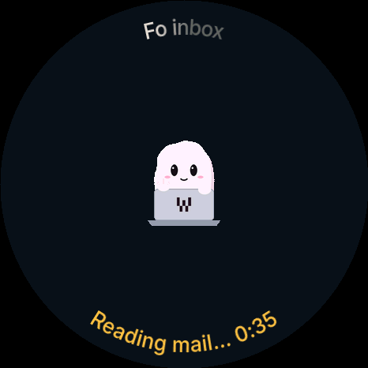
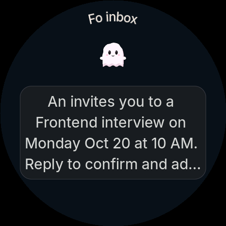

# Sample 1: the Fo glance screen

**Goal.** When an agent's recap is a *glance line*, the round device draws a screen of numbers instead of the recap
card. Say Fo is helping you job hunt and answers `GLANCE applied=5 replies=2 interviews=1 goal=10`: the device shows
three large numbers with labels, and a ring around the edge filled to 5/10.

You'll build, preview and flash the round device's firmware (`devices/harness-device/firmware`, ESP32-S3).
The daemon needs no changes: the data reaches the device along the same path the recap already takes.

The counts in the job-hunt example mean:

- `applied`: applications sent so far. A company confirming it received N applications counts all N.
- `replies`: times a company or recruiter answered an application. A receipt confirmation is not a reply.
- `interviews`: interviews scheduled or proposed.
- `goal`: this week's application goal (default 10).

What you'll build — the device with the solution applied (rendered by the firmware's own drawing code, 466 × 466):

| Working (Fo theme) | Recap: the ordinary card | Glance: the same turn as numbers |
|---|---|---|
|  |  |  |
| the status line in Fo amber instead of green | an answer without a glance line | `GLANCE applied=6 replies=0 interviews=1 goal=10` |

`preview.sh` writes the same three screens (`working.png`, `recap.png`, `glance.png`) on your Mac.

In this folder:

| File | What it's for |
|---|---|
| `README.md` | this exercise |
| `preview.sh` | renders Working, Recap and Glance to PNG on the Mac, no device needed |
| `ppm2png.py` | used by `preview.sh` to turn the renderer's PPM files into PNG (Python standard library only) |
| `solution.patch` | the full solution (theme + glance + tests). Apply it to `main` with `git apply` |
| `fo-prompt.md` | what to tell Fo so its answer starts with the glance line |

> **Install ESP-IDF early** (it takes 15-30 minutes and downloads about 2 GB). The preview step doesn't need ESP-IDF;
> the build step does:
>
> ```bash
> mkdir -p ~/esp && git clone -b v5.5 --recursive https://github.com/espressif/esp-idf.git ~/esp/esp-idf
> ~/esp/esp-idf/install.sh esp32s3
> . ~/esp/esp-idf/export.sh        # run this again in every new terminal
> ```
>
> The firmware needs ESP-IDF 5.5 or later (`devices/harness-device/firmware/README.md`).

---

## 0. The glance line format

```
GLANCE applied=5 replies=2 interviews=1 goal=10
```

- Case-sensitive, and at the **start** of the recap: either the whole recap or its first line.
- After `GLANCE` come at most **4** `key=value` pairs, separated by spaces.
  - key: `[a-z]{1,12}`. Unknown keys still show as written (`pages=12` shows the label `pages`).
  - value: an unsigned integer, **≤ 9999**.
- `goal` doesn't show as a number. It's 100 % of the ring: the ring fills to `applied / goal`. If the line has no
  `applied`, the ring counts the first number. With no `goal`, there's no ring.
- The pairs end at the end of the line, the end of the text, or the first word without an `=`. Here's why: the recap
  the device gets is the opening of the answer, with sentences joined and line breaks turned into spaces
  (`cli/src/lib/deviceRecap.ts`, `recap_preview()` in `ui_habitat.c`). For example,
  `GLANCE applied=5 goal=10 Sent 5 applications today.` is still a glance.
- A malformed line (5 or more pairs, a key with uppercase letters or `_`, a value over 9999 or not a number, two
  `goal`s, no number to show) is **not** a glance: the device draws the normal recap card.

The glance screen has the agent's name on the upper curve (as today), up to 3 large numbers (Inter 44) with labels
below them (Inter 20), a ring around the edge (`ht_ring_arc`) and the line `5 / 10 applied` on the lower curve.

## 1. Run the preview before you change anything

```bash
cd samples/hackathon-fo/01-fo-glance
./preview.sh                 # about 15 s; writes /tmp/fo-glance-preview/{working,recap,glance}.png and opens them
```

On `main` you'll see `working.png` and `recap.png`. Glance is reported missing because nothing draws it yet.
`preview.sh` runs `devices/harness-device/firmware/test/test_touch_ui.py` with `HABITAT_PREVIEW_DIR`. That test
compiles the firmware's **real UI code** for the Mac, steps through the states and writes a PPM for each screen. The
script keeps `design-claude-{working,recap,glance}.ppm` and converts them to PNG. You need `cc` (Xcode Command Line
Tools) and `python3`.

Environment variables: `OUT_DIR=...` changes the output folder, `NO_OPEN=1` skips opening the images,
`FIRMWARE_DIR=...` renders from a different checkout.

## 2. Warm-up: a Fo theme (about 30 minutes)

Add a `DEVICE_HABITAT_FO` build flag, following the existing `DEVICE_HABITAT_ORANGE`:

1. `devices/harness-device/firmware/main/CMakeLists.txt`: find `if(DEVICE_HABITAT_ORANGE)` and add an identical
   block for `DEVICE_HABITAT_FO` (`target_compile_definitions(${COMPONENT_LIB} PRIVATE DEVICE_HABITAT_FO=1)`).
2. `devices/harness-device/firmware/main/ui/habitat/theme.h`: under `#ifdef DEVICE_HABITAT_FO`, set Fo colors for
   - the `HT_THEME_FOCUS_CANVAS` background (the Focus face; a regular build has only the Focus face, flag
     `HABITAT_FOCUS_ONLY`),
   - `HT_THEME_ACCENT` (the accent color; in the main exercise it fills the glance ring),
   - `HT_THEME_VOICE` (the mic bar while you speak),
   - and add `HT_THEME_WORKING` for the "Coalescing… 0:34" line while the agent works. Its default stays `0x00ff2f`.
3. `devices/harness-device/firmware/main/ui/habitat/focus.c` does **not** read the theme for the green: it has
   `#define FOCUS_VOICE 0x00ff2fu`. Replace it with `HT_THEME_VOICE`, add `FOCUS_WORKING` = `HT_THEME_WORKING`, and
   use it in the three places that draw the working line (search for `FOCUS_VOICE` in `ht_focus_face`: the line under
   the scene, the middle line, the lower arc).
4. To preview the theme: in `test/test_touch_ui.py`, next to the `HABITAT_TEST_ORANGE` line, add
   `if os.environ.get('HABITAT_TEST_FO'): extra_includes.append('-DDEVICE_HABITAT_FO=1')`. `./preview.sh --fo`
   sets this variable for you. If an `assert` comparing a color with `0x00ff2f` fails, compare with
   `HT_THEME_WORKING` instead of the constant.

The colors are only suggestions: the solution uses a `0x081018` background, amber accent `0xffb000`, working
`0xffc040` and cyan voice `0x00e0ff`. The screen is RGB565, so colors are rounded to 5/6/5 bits.

Check: run `./preview.sh --fo`; `working.png` should have a night-blue background and an amber working line.

## 3. Main exercise: the glance screen

### Where the data flows

1. Fo answers. The daemon takes the opening of the answer as the recap: `deriveTurnSummary()` in
   `cli/src/lib/deviceRecap.ts`, called from `cli/src/core/agents/cloud.ts` (`recapOf`).
2. `cli/src/cable/cableSession.ts`, `summary()`, sends the cable frame `{ t: 'summary', agentId, recap, text }` over
   USB.
3. Firmware: `main/cable_client.c` (search for `strcmp(t, "summary")`) calls `ui_project_emit(..., "summary", text,
   recap)`.
4. `main/ui/habitat/ui_habitat.c`: `event()` stores the whitespace-collapsed recap (`recap_preview`) in `m->preview` /
   `a->preview`. `change()` hands it to the agent face: `const char *recap = ... a->preview`, then
   `ht_character_face(..., recap)`.
5. `main/ui/habitat/focus.c`, `ht_focus_face()`, draws the recap card. **This is where you make your change.**

### What to do

1. **Parser**: create `main/ui/habitat/glance.h`, header-only (`static inline`), so tests only need to include it
   instead of changing the file lists of dozens of compile commands:
   ```c
   typedef struct { char key[13]; uint16_t value; } ht_glance_pair_t;
   typedef struct { ht_glance_pair_t shown[4]; uint8_t count; bool has_goal; uint16_t goal; } ht_glance_t;
   bool ht_glance_parse(const char *text, ht_glance_t *g);   // true = glance; false = normal recap
   ```
2. **Parser tests**: `test/test_glance.c`, added to `test/run.sh` (copy the compile block of `test_character`,
   because this test also calls `ht_focus_face`). Cases to cover: a valid line, first line only, text right after the
   pairs, more than 4 pairs, bad keys (`Applied`, `applied_today`, 13 letters), a value over 9999, a missing or wrong
   `GLANCE` (`glance`, not at the start), and `goal` (not shown, two `goal`s, only `goal`).
3. **Drawing**: in `ht_focus_face()`, right after `bool has_recap = ...`:
   ```c
   ht_glance_t glance;
   if (has_recap && ht_glance_parse(recap, &glance)) { resting.showing = false; glance_face(s, f, &glance); return; }
   ```
   then write `static void glance_face(...)` above it. The drawing functions are in `main/ui/habitat/terminal.h`:
   `ht_arc_title_face` (the name on the upper curve), `ht_ring_arc` (the ring; center, radius and width in 1/16 px,
   angles counterclockwise from 3 o'clock, `width16 = 0` is an empty placeholder that holds the slot), `ht_lv_label` +
   `label_runs` (text centered in a column), `ht_arc_status_face` (the lower curve), `ht_measure`. Fonts:
   `ht_lv_inter_44`, `ht_lv_inter_30`, `ht_lv_inter_20` (`focus_faces.h`).
4. **The most important rule** (the comment at the top of `focus.c`): `ht_damage()` compares run i of the old frame
   with run i of the new frame. If the number or order of runs changes, it redraws the whole 466x466 screen. The home
   face always emits **exactly 11 runs, in the same order**. The glance screen also keeps 11 runs in its slots: name ·
   background ring (the pet's slot) · filled ring (the card's slot) · 3 numbers + 1 empty run (the 4 recap lines) ·
   3 labels (status + 2 resting lines) · lower curve. Where there's nothing to draw, emit an empty run (`no_text`,
   `ht_ring_arc` with `width16 = 0`). **Don't drop runs.**
5. The lower curve makes room for the notification bell and the footer button, like the relaxing face's line: leave it
   out when `f->notices` or `f->footer_action` is set.
6. The glance screen has no pet, so it doesn't need to redraw on a timer: in `ht_focus_pet_next_ms()`, return `0` when
   the recap is a glance.
7. **Preview**: in `test/test_touch_ui.py`, in the `THE DESIGN EXPORT` section, right after `DESIGN("recap")`, add:
   ```c
   DESIGN_HOME();
   ui_project_emit("a", "sess", "summary", "GLANCE applied=5 replies=2 interviews=1 goal=10 Sent five applications today.",
                   "GLANCE applied=5 replies=2 interviews=1 goal=10 Sent five applications today.");
   fake_ms = 1200; scene_take(); DESIGN("glance");
   ```
   After that, `./preview.sh` produces `glance.png`.

Layout hints from the solution: ring radius 227, width 8, filled clockwise from 12 o'clock (`mid = 90 - half`,
`half = 180 * applied / goal`); numbers at y 187, labels at y 248; 1, 2 or 3 columns 200, 150 or 120 px wide; a number
wider than its column drops to Inter 30.

## 4. The development loop

```bash
cd devices/harness-device/firmware

# 1. Quick look on the Mac (about 15 s), after every UI change
../../../samples/hackathon-fo/01-fo-glance/preview.sh --fo

# 2. Host tests (about 3 minutes) before you flash
bash test/run.sh

# 3. Build for the device (a few minutes the first time, fast after that)
. ~/esp/esp-idf/export.sh
idf.py -B build-fo set-target esp32s3                                    # first time only
idf.py -B build-fo -DPROJECT_VER=0.0.99 -DDEVICE_HABITAT_FO=1 build
```

**Why `0.0.99`:** the daemon pushes the official firmware over USB (OTA) to any device running a version older than
the published one. A dev build with a low version gets overwritten after about 15 seconds and your changes
"disappear". `0.0.99` is higher than the published version, so it stays.

### Flash (in this order)

Only one process can hold the serial port, and the daemon is holding it:

```bash
ls /dev/cu.usbmodem*                     # find the round device's port
osascript -e 'quit app "Harness"'        # 1. quit the Harness app
harness stop                             # 2. stop the daemon (frees the USB port)
idf.py -B build-fo -p /dev/cu.usbmodemXXXX flash   # 3. flash
harness start                            # 4. start the daemon again
open -a Harness                          # 5. reopen the app
```

Don't flash after a failed build. Check: after a while, the device still runs `0.0.99` (Devices in the app, or the
device log). Then send Fo a turn following `fo-prompt.md`: when the turn ends, the device beeps and shows the glance
screen.

### Go back to the official firmware

```bash
harness flash          # flashes the published firmware again (USB plugged in, app and daemon running as usual)
```

## 5. Stuck?

Apply the solution to a clean checkout of `main` (from the repo root):

```bash
git apply --check samples/hackathon-fo/01-fo-glance/solution.patch && git apply samples/hackathon-fo/01-fo-glance/solution.patch
```

The patch covers `theme.h`, `main/CMakeLists.txt`, `focus.c` (`glance_face`), the new `glance.h`, the new
`test/test_glance.c`, `test/run.sh` and `test/test_touch_ui.py` (the glance preview, `HABITAT_TEST_FO`). To remove the
solution: `git apply -R samples/hackathon-fo/01-fo-glance/solution.patch`.

Common errors:

- `preview.sh` reports `no .../design-claude-glance.ppm`: you haven't added `DESIGN("glance")` yet (step 3.7).
- A test reports `Assertion failed ... count == 11`: the glance screen emits too few or too many runs (step 3.4).
- The device still shows the recap card: the glance line isn't at the **start** of Fo's answer (see `fo-prompt.md`),
  or the line is malformed. Try it with the parser in `test/test_glance.c`.
- The device goes back to the old version after you flash: you forgot `-DPROJECT_VER=0.0.99`.
- `idf.py flash` says the port is busy: the daemon or the app is still running (`harness stop`, quit the app).
