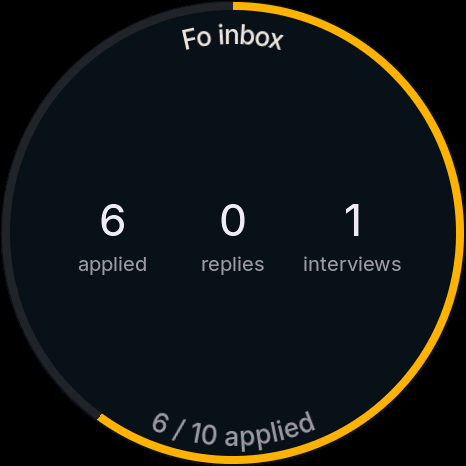
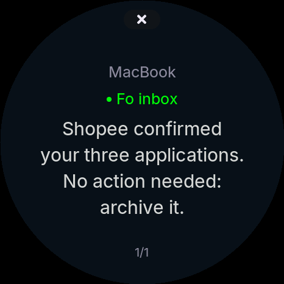

# Hackathon Fo × Harness

This guide takes your team from opening the box to running agents on the round device (Harness device), then on to two
code samples that dig into the repo. Work through the steps in order. Each step has **You should see** so you know it
worked, and **Stuck?** for when it didn't.

> You need a Mac (macOS 12 or later), a Google, Apple or email account, and the round device with a USB-C cable that
> **carries data**. Harness Desktop runs on macOS and Linux. There is no Windows version yet.

- [1. Install Harness and sign in](#1-install-harness-and-sign-in)
- [2. Run your first agent (Claude Code, Codex, …)](#2-run-your-first-agent)
- [3. Add Fo and run an agent with Fo](#3-add-fo-and-run-an-agent-with-fo)
- [4. Plug in the round device and work with agents on it](#4-plug-in-the-round-device)
- [5. Troubleshooting](#5-troubleshooting)
- [6. Repo map](#6-repo-map)
- [Sample 1 — Fo glance: your own firmware screen for the round device](01-fo-glance/README.md)
- [Sample 2 — Desk assistant: new email → Fo → round device](02-desk-assistant/README.md)

---

## 1. Install Harness and sign in

1. Download **Harness Desktop** from https://harness.autonomous.ai/desktop → **Download the app for macOS**, drag
   Harness into Applications and open it. (Linux: download the AppImage, `chmod +x` it, then open it.)
2. Sign in with **Continue with Google**, **Continue with Apple** or **Continue with email**. Your browser opens a
   sign-in page. When you're done, go back to the app.
3. On first run the app installs everything else for you: the `harness` command-line tool
   (`~/.local/bin/harness`), tmux, and the background daemon, which it starts. Nothing to install by hand. Check in a
   new terminal:

   ```bash
   harness --version   # the CLI the app installed
   harness status      # the daemon is running and signed in to your account
   ```

**You should see:** the app opens your workspace; `harness status` shows `status ● running` and `local api
http://127.0.0.1:18473`.

**Stuck?** `harness: command not found`: open a new terminal (the app adds `~/.local/bin` to your PATH), or run
`~/.local/bin/harness`. `harness status` says signed out: run `harness login` with the same account as the app.
Every machine on the team must sign in to **the same account** to see each other. To replay the in-app
guide: Help ▸ Welcome Tour.

## 2. Run your first agent

Harness doesn't replace your agent. It runs each vendor's own CLI and keeps track of it. So **first install and sign in
to the CLI of the engine** you want to use:

| Engine | Command | Sign in |
|---|---|---|
| Claude Code | `claude` | run `claude` once and follow the prompts |
| Codex | `codex` | run `codex` once and sign in |
| Muse, Cursor, OpenCode, … | `muse`, `cursor-agent`, `opencode` | same as above |

Then, in the app:

1. **New Harness** (⌘N).
2. Pick the **machine**, the working **folder** (or **Clone repository** to clone a GitHub repo), and the **engine**
   (Claude Code, Codex, …). Advanced has the permission mode (the default is the engine's auto-approve).
3. Type your task into the pane that opens.

Or from the terminal:

```bash
harness new                         # Claude Code in the current folder
harness new codex ~/code/my-app     # Codex in the given folder
harness new codex my-game           # creates a new project in ~/harnesses/my-game
```

**You should see:** the agent's terminal pane. The top tab shows a spinner while the agent works and ✓ when it's done.

## 3. Add Fo and run an agent with Fo

Fo is Wajo's agent. It runs **on Fo's cloud**, not on your machine. Harness talks to Fo over MCP, so "signing in to
Fo" means adding Fo as a Connection:

1. **Settings ▸ Connectors ▸ Add custom**.
2. **Name**: `Fo`. **Remote MCP server URL**: `https://mcp.api.wajo.ai/fo`. Click **Continue**.
3. Your browser opens the Wajo sign-in page. Sign in, then go back to the app.
4. **New Harness** (⌘N) ▸ under **Agent**, pick **Fo**. The Computer field switches to **Fo's cloud** on its own (Fo
   needs no folder, model or permissions). Type a task, for example: *"Find me 3 quiet coffee shops in District 1
   that stay open until 10 pm"*.

**You should see:** a chat pane (not a terminal). Fo may answer right away, or say it's working and answer later. When
Fo asks you something and offers choices, the question shows up for you to pick an answer.

**Stuck?**
- You see `NOT_CONNECTED` / "Connect Fo in Connections…" → steps 1–3 aren't done. Do Add custom again.
- You can't stop Fo from Harness. Closing the pane only stops following it ("Fo keeps working on its own").
- Claude Code and Codex can use Fo's tools through the same Fo connection.

## 4. Plug in the round device

1. Make sure Harness is running on the Mac (`harness start`, app open).
2. Plug the round device into the Mac with a **USB-C data cable**. There's no Wi-Fi and no pairing code: plugging it in
   connects it.
3. In the app, click **Manage Harness devices** in the toolbar → **"Plug in. Make it yours."** → wait for
   "Waiting for a USB connection…" to change to your device → set a **Device name** → **Finish setup**.

**You should see on the device:** the word **Harness**, then the pet of the selected agent. The device follows the app
window: the tabs and panes open in the app are what the device shows.

**Working with agents on the device (touch):**

| To | Do this |
|---|---|
| Pick an agent | tap the agent's tile; drag to scroll the list |
| Switch tabs | hold on the main screen to open the tab list, release to open one |
| Talk to the agent | **hold the face for about 0.65 seconds** → *Listening* appears → speak → release to send |
| See what the agent is doing | the **Working** screen: the pet at work, the current task and a timer |
| See the result | when the agent finishes its turn, the **Recap** screen sums up what it did |
| Notifications | a bell with a count on the screen → tap it to open **Notices** (one per page, ✕ to close) |
| Interrupt the running turn | press the **BOOT** button once |

Try it now: on the device, pick the Claude agent from step 2, hold the face and say *"list the files in this folder"*,
release, and watch the device go from Working → Recap. Then do the same with Fo.

**Note:** when an agent asks for permission (approval), the device only **tells** you. Approve it in the app or the
terminal.

## 5. Troubleshooting

| Symptom | Common cause | What to do |
|---|---|---|
| The app doesn't see the round device | the cable is charge-only | use a data cable, plugged straight into the Mac |
| The device shows Harness, then stays on "Loading..." | the daemon isn't running | `harness start` |
| The agent pane shows an error as soon as it opens | the engine isn't signed in | run `claude` / `codex` in a terminal and sign in |
| Fo reports `NOT_CONNECTED` | the Fo connection wasn't added | redo section 3 |
| The device doesn't show the agent you just created | the agent isn't bound yet | wait a few seconds; if it still isn't there, run `harness logs export` and send it to the Harness team |

## 6. Repo map

| Folder | What it is | Used in |
|---|---|---|
| `devices/harness-device/firmware/` | the round device's firmware (ESP32-S3, ESP-IDF, C) | Sample 1 |
| `devices/harness-device/firmware/main/ui/habitat/` | all the screen drawing: `focus.c` (the Focus face), `theme.h` (colors), `terminal.h` (drawing primitives) | Sample 1 |
| `devices/harness-device/firmware/test/` | tests that run on the Mac, including a renderer that writes screens to images | Sample 1 |
| `cli/` | the `harness` daemon (TypeScript): agents, engines, devices, Fo (`cli/src/cloud/fo.ts`) | Sample 2 |
| `cli/src/cable/` | the daemon ↔ round device protocol over USB | further reading |
| `desktop/` | the Harness Desktop app (Flutter) | further reading |
| `docs/` | `app.md`, `cli.md`, `engines.md`, `architecture.md` | further reading |

| Sample 1: your own firmware screen | Sample 2: email reaches you on the device |
|---|---|
|  |  |

When you're ready, go on to [Sample 1](01-fo-glance/README.md) and [Sample 2](02-desk-assistant/README.md). The two
samples connect: Sample 2 feeds email to Fo, Fo answers with a line of numbers, and the Sample 1 screen draws those
numbers on the round device.
